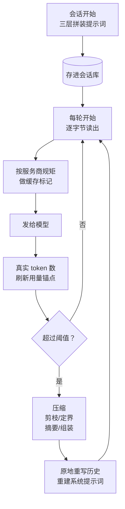

# 上下文工程

hermes 的上下文子系统：系统提示词怎么组装、怎么靠提示词缓存便宜地反复发、装不下时怎么压缩。
发给模型的请求由工具清单、系统提示词、对话历史三块组成，本篇的主线对象是后两块。工具清单的冻结与滚动归
《Agent 主循环与编排》篇 Q2；跨会话的记忆怎么存取归《记忆系统》篇，本篇只讲记忆快照怎么嵌进提示词。

## 重点地图

按面试出现频率分层，时间紧就先看三星：

- ⭐⭐⭐ **必考，要能脱口而出**：Q1 全景、Q2 提示词组装、Q3 缓存、Q4 压缩触发与 token 计量、Q5 压缩算法
- ⭐⭐ **高频，要会讲**：Q6 压缩的失败处理
- ⭐ **了解思路即可**：Q7 可插拔上下文引擎、Q8 微压缩、Q9 开放题

## Q1：上下文工程是干什么的？核心机制主要流程是什么？ ⭐⭐⭐

> **一句话：** 管一份请求的三件事——上下文装什么（组装）、怎么便宜地反复发（缓存）、装不下怎么办（压缩）；贯穿全局的约束是对话历史一经发送就不改写，唯一例外是压缩。

**主答：**

模型是无状态的，每次调用都要把整个上下文重新发一遍：工具清单、系统提示词、完整对话历史。上下文工程就是管这份请求的三个问题——装什么、怎么便宜地反复发、装不下怎么办。

hermes 的答案看图：会话开始时，系统提示词按「稳定→易变」三层拼一次、存进会话库，之后每轮逐字节读出来用；发请求时按服务商的规矩做缓存标记（要显式标断点的就标，隐式缓存的什么都不用加）；每轮拿模型返回的真实 token 数刷新用量锚点（锚点＝记下的最近一次真实用量，之后只对新增内容做估算，Q4 展开），超过阈值（默认一半窗口）就压缩——中段摘要掉、头尾保住，然后原地重写历史、重建提示词。

一条全局约束贯穿三件事：**对话历史一经发送就不改写**——改一个字节，缓存前缀就从那里开始全部作废，压缩是这条禁令唯一的例外。另外两块的变与不变各有安排：系统提示词字节稳定，只在压缩时顺带重建（把本会话新写的记忆折进去）；工具清单不是完全不动，但顺序钉住、变化只发生在列表末尾、按轮次滚动（滚动机制在《Agent 主循环与编排》篇 Q2）。

### 追问：这里的「上下文」和「记忆」是什么关系？

上下文是**当前这份请求里模型看得见的全部**，会话结束就没了；记忆是**跨会话的库**。记忆是上下文的原料：会话开始时，记忆快照作为一层嵌进系统提示词。反过来，会话中途写的新记忆不进当前提示词（字节不能动），要等压缩重建或下个会话才生效——存取机制的完整展开在《记忆系统》篇。

### 追问：这和常说的 RAG 是什么关系？

一句话分清：**上下文工程管的是发给模型的有限窗口里装什么**——强调对内容的管理；**RAG（检索增强生成）是从外部知识里检索出相关内容补进请求**——强调检索。hermes 里检索形态的东西也有：会话检索工具（找回被压缩掉的内容，Q5）、Q7 留给插件做请求级检索的口子——但默认的上下文管理不靠检索，靠组装、缓存、压缩三件套。

## Q2：系统提示词是怎么组装的？ ⭐⭐⭐

> **一句话：** 三层拼装——稳定层（身份、行为指引）→ 上下文层（项目上下文、工作区快照）→ 易变层（技能索引、记忆、时间、环境），越容易变的越靠后；每会话拼一次存库，之后字节不动。

**主答：**

会话开始时拼一次，三层按「变化频率从低到高」排：

1. **稳定层**：身份（用户自定义的 SOUL.md，没有就用内置默认）、工具相关的行为指引、编码操作纲要。这些换会话都未必变；
2. **上下文层**：项目上下文文件（AGENTS.md 这类）、git 工作区快照（仓库根、分支、改动概况这几行状态）、平台提示（「你在终端上，别用 Markdown」这类）；
3. **易变层**：技能索引（技能＝按需加载的指令包，教 agent 干某类活的操作手册）、记忆快照、时间戳、运行环境（主机、当前目录）——这些每次重建都可能变。

排序的目的是缓存：提示词缓存按最长前缀匹配，前缀里的字节越稳、越长，能复用的部分就越大。

### 追问：系统提示词为什么不放内存，而要存库？
拼完存进会话库，之后每轮读同一份字节——存库而不是放内存，是因为同一个会话不只有一个进程在用：网关进程跑一轮，命令行可以从另一个进程恢复同一个会话，跨进程共享内存本来就得靠共享存储，现成的就是这块状态库。如果要使用共享内存缓存，就得使用 redis 这种组件，后续还得解决 缓存和库数据一致性问题，不值得。

### 追问：项目上下文文件是怎么发现的？

按优先级找，**第一个有内容的类型胜出**，后面的不再看：

1. `.hermes.md` / `HERMES.md`——从当前目录往上走到 git 根，找到最近的一份；
2. `AGENTS.md`——沿着「git 根 → 当前目录」的每一级目录收集，各级合并注入（每级目录里若有 override 覆盖文件——本地另存的一版——优先于正式文件）；子代理这类跳过上下文文件的会话不加载；
3. `CLAUDE.md`——只看当前目录（兼容 Claude Code）；
4. `.cursorrules` 和 `.cursor/rules/` 下的规则文件——只看当前目录，多份按序合并（兼容 Cursor）。

一个值得讲的细节：官方文档说 AGENTS.md 只看当前目录，代码实际已经演进成目录链合并——子目录里的规则和仓库根的规则会一起进提示词。这是文档滞后的例子，也说明这块还在活跃改动。

### 追问：这些文件直接进提示词，不怕提示词注入吗？

进场前过一遍威胁模式扫描（看不见的 Unicode 字符、「无视之前的指令」这类模式）：

- **项目目录里的文件**命中模式：整块替换成「已阻断」的占位说明——它随仓库一起来，不可信；
- **用户自己主目录下的 SOUL.md** 命中：警告一声、照常加载——它和配置文件同一个信任级别（用户自己写的身份文档里出现「ignore previous instructions」这个词本身不奇怪）；扫描要是把它整个扔掉，用户的身份就莫名其妙没了。

扫描用哪些模式、怎么分级，完整展开在《安全与审批》篇。

### 追问：文件太长怎么办？

头尾截断：保留前七成、后两成，中间换成省略标记，标记里告诉模型「要完整内容就用读文件工具去读原文件」。上限默认两万字符，随模型的上下文窗口放宽（大窗口给更大额度，五十万字符封顶），配置里显式指定则一律优先。

### 追问：哪些内容天然会变，怎么钉住？

这是个「为字节稳定把能钉的都钉住」的清单：

- **git 工作区快照**：会话第一次探测后把字节钉在会话上，压缩重建时直接重放旧字节，不重新探测——仓库中途动了也不影响当前会话；
- **时间戳**：只写到「天」，一天内字节不变；「会话开始时间」取的是这条会话最初创建时的 id——id 本身按「日期_时间」的格式生成、嵌着创建时刻，所以跨多次压缩也稳定。跨天的会话在重建时补一行「今天是几号」——重建点缓存反正已经失效，这行不额外付缓存代价；
- **插件注入的段落**：渲染一次冻结；恢复会话时从存下来的提示词字节里解析回来，不重跑插件代码；
- **平台切换**（桌面↔终端）：不重建提示词——提示词里那层平台说明是会话开始时定下的，不跟着换界面重写；当前平台的提示改走一条一次性的用户消息。这样换了界面，缓存前缀还活着。

### 追问：业界其他主流的 agent 是怎么组装系统提示词的？

> **一句话：动态内容不进系统提示词——放进用户消息，每轮检查变化，变了就往对话末尾追加一条、不动前面的内容：新信息拿到了，缓存前缀也没破坏。**

Claude Code、Codex CLI、DeepSeek 官方 harness 三家（2026 年的情况）做法同构：基础指导会话内冻结，动态内容（环境、日期、项目上下文文件）放用户角色的消息里，每轮检查、变了才追加，旧条目原样保留——模型按「越靠后越新」或新条目里一句「取代之前的」理解。各家的辨识点一句话：

- **Claude Code**：提示词缓存全体用户共享一份，工程师原话「命中率掉了要当线上事故上报」；动态内容嵌在工具描述里曾占全机队约一成的缓存写入，这个教训把「动态内容不进前缀」变成硬纪律。CLAUDE.md、日期这类稳定内容更省事：不落历史，每轮组装请求时临时拼一份冻结的相同字节；
- **Codex CLI**：追加的消息只含变化的部分；AGENTS.md 沿仓库根到当前目录逐级拼接（hermes 的目录链就是这同一套约定）；
- **DeepSeek 官方 harness**：它家缓存放磁盘、全自动、保留几小时到几天，harness 顺势把保前缀做严——快照变更追加一份全量新快照（带取代声明），连压缩的摘要调用都逐字节重放主对话前缀（用不上的工具清单也原样带上，为了缓存对齐）。

hermes 在这个谱系里算「激进钉住派」：项目上下文文件、git 快照、日期（到天）、记忆快照全钉进系统提示词——变更只能等压缩点或下个会话生效，换来这些东西一直躺在被缓存的前缀里、同配置的会话能共享前面整段；上面三家把同类内容放消息通道，变更即时、也不破坏已有前缀，代价是这些内容分散在各自会话的消息里，进不了跨会话共享的前缀。

## Q3：提示词缓存具体是怎么做的？ ⭐⭐⭐

> **一句话：** OpenAI / Gemini 系什么都不用做（隐式缓存全自动）；Anthropic 系要管断点——hermes 按路由摆：直连时稳定层、工具清单末尾、最后两个完成的轮次；转发时稳定层、系统提示词末尾、最后两条消息。

**主答：**

业界分两种世界：OpenAI 和 Gemini 是隐式缓存——什么都不用配，请求前缀够长且和上次相同时自动按折扣计费；Anthropic 是显式缓存——必须在请求里的特定位置标缓存断点 (cache_control)，一个请求最多四个，不标就没有。hermes 对前者零操作，对后者摆断点，而且按路由分两套摆法：

- **直连 Anthropic 官方接口**：系统提示词的**稳定层**（就是 Q2 三层里最稳的那层）一个、**工具清单的末尾**一个、最后两个**完成的轮次**（一条模型回复连同它的工具结果）各一个——工具清单是每个请求里仅次于系统提示词的稳定大头，单独锁住；
- **经 OpenRouter 这类转发**：稳定层一个、**系统提示词末尾**一个、最后两条能带标记的消息各一个。

所有标记只加在发出去的请求副本上，存库的消息还是纯文本；重复加标记是幂等的（先剥旧的再放新的）。

### 追问：缓存到底为什么能省钱？

模型产出一段回答不是一次算成的，是一个字一个字迭代出来的：每一步基于「已有的全部内容」算出下一个字，新字拼回序列、进入下一步，循环到说完。每一步里最贵的动作是注意力——当前这个字要和前面**每个**字算一遍相关性：前面每个字手里各备着两样中间结果，一个当**索引**（K）、一个当**内容**（V），当前字拿自己的查询去挨个比对索引、按匹配程度把内容加权取回来。这些索引和内容算过就存下来（业内合称 KV 缓存），关键是旧字的这两样**不随序列变长而改变**——算一次就能一直用。

浪费就出在多轮对话。第二轮请求＝系统提示词＋完整历史＋那条新消息——前九万个 token 和上一轮请求**一模一样**，它们的中间结果上一轮就算出来了，但服务端还得把这九万个字从头重算一遍。对话越长重复越狠：聊十轮，同一段前文可能白算了十遍，而且每轮都在等这段重算——延迟也是这么来的。

厂商推缓存就是冲这份浪费来的：把算过的索引和内容留在自己机房（显存或硬盘），下一轮请求如果就是上一轮请求**原样**＋末尾追加新内容，旧前缀那部分的中间结果直接拿来用，从新内容接着算。计价跟着真实成本走：命中的部分几乎零计算，所以敢打一折；有的厂商对写入收点加价，收的是存这份中间结果的存储成本。而比对必须逐字节、也只能从头比，是计算结构决定的：每个字的中间结果由它前面**全部**内容算出，环环相扣——前面差一个字节，后面全对不上。

### 追问：缓存坏了，损失到底多大？
1. **费钱**：命中的部分按折扣计费（各家一折这个量级），没命中全价重算——系统提示词加历史动辄几万甚至几十万 token，每轮全价重来，长对话成本成倍涨。
2. **延迟高**：复用的部分不用重算，第一个字出来得快；全量重算就得多等一段。

### 追问：断点为什么这么摆？

先说断点是怎么用的：一个断点等于告诉服务商「从请求开头到这个位置，存成一份缓存」。下一轮请求来了，服务商拿你的开头和存的缓存逐字节比——对上到某个断点，那个点之前的内容按命中价计费，完全对不上就全价重算、重新存一份。一个请求最多四个断点，就是最多画四条「缓存到此为止」的线——线画在哪，决定钱省在哪。

拿直连时一个真实请求的形状走一遍。请求从头到尾：**工具清单**（一份二十个工具的说明书）→ **系统提示词**（Q2 的三层）→ **历史**（若干轮对话，每轮＝用户消息＋模型回复＋工具结果）→ 本轮新消息。四个断点这么摆：

1. **工具清单末尾**：工具说明几乎从不变，这段存一次、之后每轮白拿命中；
2. **系统提示词的稳定层末尾**：提示词里最不会变的那段；后面的易变部分不标——标了跨会话容易失效，白白占名额；
3. 和 4. **最后两个完成的轮次末尾**：滚动窗口，跟着对话往前挪。

滚动窗口拿两轮对照最直观：上一轮请求结束时，缓存的终点落在当时的最后一轮（比如第三轮）末尾；这一轮请求＝同样的开头＋第四轮＋新消息——服务商比对开头，一路对到第三轮末尾的断点，这段全部命中，只有第四轮和新消息按全价算，同时这一轮又把断点标到第四轮末尾。下一轮来，前四轮又能命中。对话就这样一格一格往前滚，每轮只为新增的部分付全价。

转发路径（OpenRouter 这类）摆法不同但原则一样：工具清单上挂不住 Anthropic 的标记（转发走 OpenAI 风格的格式，标记字段在工具条目上没有位置，部分代理见到还直接报错），省下的断点花在系统提示词末尾；消息上能带标记的位置也少（空内容的消息、纯工具结果都挂不上），滚动窗口就不挑位置了，取最后能带标记的两条。

### 追问：哪些操作会白白破坏缓存？

改内容会作废缓存是明摆着的（从第一个不同的字节起后面全失效），另有两类要么躲不开、要么要靠纪律避开：

- **服务商侧的隔离，躲不开**：缓存按组织隔离，模型也是缓存身份的一部分——**中途换模型**，或**跨账号轮换凭证**（不同组织的 key，比如降级时换到了别家账号），下次请求零命中，整个对话全价重读。agent 避免不了，只能少做；
- **内容类操作，hermes 靠纪律避开**：**改历史中间**（插话、修正都只追加在末尾，不打进历史中间）、**换系统提示词或工具清单**（所以技能变更默认推迟到下个会话生效；工具上下线引起的清单滚动下一轮会话才生效，Q1 提过。

## Q4：上下文什么时候压缩？怎么知道现在有多大？ ⭐⭐⭐

> **一句话：** 两层触发——agent 循环里的主压缩器（默认 50% 窗口，真实 token 计量）加网关安全网（85%，进 agent 前兜底）；token 数靠用量锚点：服务商上报的真实数＋此后追加消息的估算增量。

**主答：**

主压缩器跑在 agent 循环里，在历史会变长的每个时机检查：轮次开始、发请求前、工具结果贴回后（Q1 的图把检查画在收到回复之后那一个点，是简化——实际这几个时机都查），外加一个可选项——会话空闲一阵子之后被再次唤醒时先压一把，趁没有人等回复，把压缩的停顿提前消化掉。默认阈值是窗口的 50%，可配、可按模型覆盖；

网关在把消息交给 agent 之前还有一道 85% 安全网，接住从主压缩器手里漏掉的会话——典型是消息平台上过夜堆积的会话，上一轮结束时还好好的，第二天消息进来时已经超了。阈值故意比 agent 高：要是也设 50%，同一个会话会被两边抢着压。

「现在多大」靠**用量锚点**：模型每次响应都带真实 token 数（这次请求实际算了多少），锚点把它记下来，之后只对「这一刻之后新追加的消息」做粗略估算加回去。锚点按内容指纹绑在那段已计费的历史上、持久化在会话行里——网关每轮从库里重读历史、进程随时会重启，内存里的计数靠不住，锚点能对上指纹才生效。

### 追问：为什么 50% 就动手，不等窗口快用满？

压缩的代价大，不能频繁触发。每压一次要做三件事：调一次摘要模型、整个缓存前缀作废、重建系统提示词——这份代价每次全额付。

但是也不能太晚压：1. 快满了才压，压完占用还在高位（尾部保留和摘要本身就占不少地方），很快又顶到。
2. 留余量：触发线以上要装得下大工具结果（读个大文件、跑个长命令）一次就能顶进几万 token；还要给摘要留地方。

### 追问：token 数靠估不行吗？估错了怎么办？

其实不是靠估。模型每次回答都自带真实 token 数（这次请求实际算了多少），锚点把它记成基准，之后只估算**新增消息**的量——增量小，估错也有限。只有没有锚点时（首次请求、用户倒回会话重发）才整段粗估。

估大估小都有兜底。估大了——以为超了、其实没超——不动手，等下一轮模型回答带回的真实 token 数再判：真没超就不压，省下一次白干（一次摘要调用＋缓存报废）；真超了照压不误。估小了——真发出去装不下、服务商以「上下文超限」拒回——恢复逻辑**无视冷却立即压一次**：服务商已经证明装不下，再等冷却就是每轮撞墙。

### 追问：图片怎么算 token？

按**从服务商的用量里学到的单图成本**计价：某次响应比上次多进了 N 张图，真实 token 数和「把图换成纯文本估出来的那份 token 数」的差额除以 N，就是这个模型一张图的价钱，按模型＋服务商存下来。第一张图进上下文之前没有数据，用 1500 的默认值。压缩触发、圈尾部的预算、网关安全网用的是同一个数字，不会各算各的。

## Q5：压缩算法本身是怎么做的？ ⭐⭐⭐

> **一句话：** 四阶段——免费剪掉旧工具结果、定头尾边界、中段交给摘要模型出结构化摘要、拼回去原地重写；重复压缩时更新旧摘要而不是从头重写。

**主答：**

1. **剪旧工具结果**：过长的旧工具结果整块换成一行占位符。不调模型、零成本，而工具输出（读文件、命令回显）正是上下文的大头，这一步往往就省出大量空间；
2. **定边界**：会话开头的第一轮保住，尾部按预算从后往前圈，并保证最近几条真实用户消息（用户自己打的）逐字留在尾部。切点不能拆散一对工具调用：模型发的调用请求和 agent 执行完贴回的结果，要么都留下、要么都进中段被摘要——拆开的话留下的那条就配不上对了，这种请求服务商直接拒收；
3. **生成摘要**：中段整体发给摘要模型（和主模型分开配，可以用便宜模型），产出一份结构化摘要，长度随内容量缩放；有旧摘要就**更新**它，不从头重写；
4. **组装**：头＋摘要＋尾拼回去，顺手清掉被压散的调用和结果对，然后**在同一个会话上原地重写**。

这套「到线触发、摘要中段、保头尾」的骨架就是业界主流——Claude Code 的自动压缩是同一个思路，hermes 在压缩算法本身没有另辟蹊径。

### 追问：摘要为什么要用结构化模板？

模板字段是为「恢复之后要用」设计的——摘要模型照着填，真正读它的是恢复后的主模型：目标、约束、进展、关键决定、下一步这类字段。两个字段值得单独讲：

- **未竟任务**单列且标成最重要的字段——用户最近一个没被满足的输入（待办、待答的问题、等确认的选项）。压缩最容易出的事故就是模型忘了自己欠着什么，恢复后对着摘要问「所以用户要什么来着」；
- **安全约束必须逐字引用、禁止改写**——用户说过「不许动那个文件」「凭据不许落盘」，转述成大意就可能丢掉约束的力度。改写丢细节对一般内容可接受，对约束不可接受。

### 追问：压缩会丢什么？丢了怎么找回？

丢的是中段细节——原文被换成摘要，不在上下文里了。但**丢的内容找得回**：被压掉的轮次没有删，软归档在会话库里（标记为已压缩但没删），会话检索工具能按关键词搜回原文。摘要里留了检索的线索——每条用户消息逐字引用，文件路径、报错原文这些做成一份从原文抽的索引，模型照着线索知道该去检索什么，要用再查。

### 追问：多次压缩怎么办？

迭代更新：摘要模型拿到「旧摘要＋新轮次」，被要求在旧摘要的结构上合并——条目从「进行中」挪到「完成」、新决定加进来、过时的删掉。从头重写的问题在于信息在多次压缩之间累积丢失：每次都只看最近一段，最早的信息第二轮就被丢了。

## Q6：压缩失败怎么办？ ⭐⭐

**主答：**

失败处理是多层兜底：

1. **失败后先冷却**。压缩失败（典型是负责摘要的模型挂了）就进一段冷却期，期间自动压缩停手、轮次照常继续迭代；冷却一次比一次长，状态记在库里、进程重启也还在。冷却一过，下次到线照常再试正常压缩——冷却只是把重试推迟，不是放弃。用户手动要求压缩、服务商明确报「上下文超限」这两种情况不等冷却，立即动手。冷却跟着具体失败的模型和服务商记，换了模型就清掉冷却、立即给一次新机会；
2. **反复失败就换不依赖模型的降级摘要**。摘要模型连着几次失败，说明它暂时靠不住，这次压缩改用降级摘要：模板还是 Q5 那份结构化模板，但字段不由模型填，而是代码从被压的历史里机械抽出来填进去——用户原话、做过的动作、涉及的文件、报过的错；抽不出来的字段就老实写「没抽到，自己去查当前文件和 git 状态」，再附上上一份旧摘要保底。压缩照常完成，损失的只是摘要质量。降级是单次行为：冷却过后下一次仍先试正常摘要，成功一次就完全回到正常；
3. **压了也没用就停掉自动压缩**。判定看压完之后下一次的真实占用有没有降回触发线以下，连续两次没降回来，或者连续两次只能靠降级摘要撑过去，就停（第一次没用之后，下次到线还会再给一次机会，再没用才停）。压了没用一般是两种情况：可压的中段本来就没多少，占用的大头在受保护的尾部；或者压不掉的部分太大——系统提示词加工具清单挂很多工具时能到两三万 token，小窗口模型上光这一块就顶过触发线。两种情况再压都是白花钱。停掉后每隔几分钟放一次试探，条件变了（换了窗口更大的模型、历史又攒出可压的新内容）就自动恢复；真没救的会话最坏也就是几分钟试一次，不会每轮空转。

兜底保证：任何失败路径都不丢对话记录——放弃压缩就原样返回没动过的历史；真到压不掉的地板超过硬上限、会话在这台模型上装不下了，网关的终极处理是自动重置会话。

### 追问：为什么「降级摘要」比「跳过压缩」好？

跳过 = 这次不压了，会话继续涨，涨到硬上限，网关的终极处理是自动重置——整个会话丢掉。降级 = 压缩照常发生，损失的是一段有界的摘要质量（中间窗口的信息变粗）。两害相权：摘要质量换会话存活。

### 追问：冷却期间上下文还在涨，怎么办？

冷却是分钟级的短窗口，多数时候等它自然过去就恢复了。真在冷却里涨到装不下，服务商会明确报错，这条恢复路不等冷却、立即压一次；如果第三步的停机也开着，这次强制压同样被拦，剩下两条路：等几分钟的定期试探，或者用户手动压缩——手动不受任何限制。最坏的组合下兜底还是网关的自动重置：宁可重开会话，不让它带着装不下的历史一直撞墙。

## Q7：上下文管理只能有损摘要吗？想换无损方案怎么接？ ⭐

**主答：**

不用改核心——压缩策略从一开始就没写死在核心里，而是抽成了一个可整体替换的策略：上下文引擎。接口就三个核心动作：报用量（每次模型响应后）、判阈值（该不该压）、执行压缩。主压缩器只是默认实现，无损方案（原文全存外部、按需检索回来）做成插件就能整体换掉——配置里显式写引擎名才激活，装了插件不会自动切换。

「有损摘要只是当前的最优解，不是唯一解」就是留这个口子的理由：长会话上摘要会累积损失（迭代更新缓解但不消除），无损方案保真更好、但要自己管存储和检索的成本。两种方案各有适用场景，接哪套不该要求改核心代码——这是「核心保持极小、能力挂在外围」那条全局设计原则（《总体架构与设计思想》篇）在上下文子系统上的落点。

除了把上下文变短，接口上还留了两个默认为空的钩子，把另外两件事也交给引擎：**请求级上下文选择**——每次发请求前，引擎可以换掉这次请求实际发出的内容（检索增强、话题路由——按当前话题挑相关的一段历史发、其余不发），只影响这一次请求、不改落库的历史；**轮后观察**——每轮结束后给引擎看一份只读的对话记录，为下一次选择积累状态。两个钩子出错都当没这个钩子（选择钩子出错发原始请求，观察钩子出错跳过这次观察），没实现的引擎一个字节都不多花。引擎还能把自己的工具带进请求给模型当普通工具调（比如无损引擎配一个「查自己的知识库」的检索工具）——主压缩器没这个需求，所以没用上。既然可插拔，每个 agent 实例就各克隆一份引擎，防止预算计算在会话之间互相串。

### 追问：那「每轮观察会话内容、同步进外部库」这种需求，该写成引擎还是记忆插件？

写记忆插件。引擎**拥有**这个会话的压缩策略（它决定历史怎么变形）；记忆插件只**观察**轮次、不拥有任何东西。拿观察的需求去实现引擎，等于为了一个钩子接管了整个压缩策略——错位。分界线就是「要不要为压缩负责」，完整展开在《插件体系》篇。

## Q8：微压缩是什么？为什么默认关？ ⭐

**主答：**

微压缩就是把压缩摊到每一轮。对照它要解决的问题：默认的批量压缩是一次性付账——跨过阈值那一刻，会话停下来、一段大摘要、再继续。微压缩改成每轮结束后，把还没并进摘要的「一组交流」里最老的一个，折进一份滚动摘要。一组交流就是 Q3 里说的「完成的轮次」那种单位——一条模型回复连同它的工具结果，到下一条用户消息为止。占用曲线从「锯齿爬到阈值再砸下来」变成「低位平稳」，批量压缩基本不再触发。

三个设计点：**用户消息永不压缩**——一组交流从模型的消息开始数，用户原话全程逐字保留。不对称是有意的：模型的输出是「干了什么的叙述」，摘要损失小；用户的指令是一切的源头，改写它就是「六轮之后自信地做了你说过不许做的事」的成因；**滚动摘要防膨胀**——摘要自己超过两千 token，就把它重新摘要一遍；**失败跳过**——同一组交流连续三次摘要失败就跳过它，不让一组坏交流卡住整条流水线。

默认关的原因是缓存：微压缩每轮改写已发送的历史，等于**每轮把缓存前缀作废一次**——批量压缩才一次付这个代价。缓存折扣深的服务商上，每轮的缓存损失可能超过摊平停顿的收益，所以这必须是用户算过账之后的显式选择（有个频率旋钮：每 N 轮吸收一次，在「多久破坏一次缓存」和「摘要跟得上新内容」之间折中）。

## Q9：你觉得这套上下文子系统有哪些地方可以优化的？ ⭐

**主答：**

最重要的一点：**压缩的决策过程对谁都不可见，可以让模型看见**。

目前的问题：hermes 曾经给用户看过上下文水位提示，因为频繁刷屏扰民被整体移除了；发给模型的提醒倒是有一个——轮次迭代的预算检查点（「这轮的调用次数用了多少」），但它默认关闭，代码注释记着原因：中间压力警告会让模型**过早放弃**复杂任务。结果是默认配置下谁都看不到水位：用户看不到，模型也收不到任何提示。而「警告会吓退模型」和「模型不该知道水位」是两回事——问题出在那条提醒的**语义**（催迫性的「快不行了」），不在知情权本身。模型不知道上下文还剩多少，就不能主动省着用：预感要长输出时先把中间结论落盘、大任务先收个尾再继续，这些它都做不了。

方案：借用现有的系统代发用户消息通道（平台切换提示走的就是它，Q2），每轮带一行**事实性水位**——「当前上下文占用约 N%」，不带任何催促语气；同时在提示词里给一条行动指引：占用高时先把中间产物写进文件、大输出前先收个尾，而不是硬撑。数据从哪来：用量锚点每轮都在更新，百分比现成的；这条通道本来就不碰系统提示词、不破坏缓存。想再进一步，可以把压缩做成模型可调的工具——上下文引擎的接口本来就支持引擎把自己的工具带进请求（Q7），只是主压缩器没这么做。

为什么更好：把「什么时候压」从纯系统侧决策变成模型可参与的决策——系统侧的阈值是全局静态的，而模型知道自己接下来要干什么（要读大文件还是要长篇输出），它是最有资格做「现在省一点」判断的一方。代价要认：每轮多几十个 token 的固定开销；指引要写得克制，防止换个形式又把「快放弃」的语义带回来——所以只给数字和「可以做什么」，绝不给「快满了」的判断。
