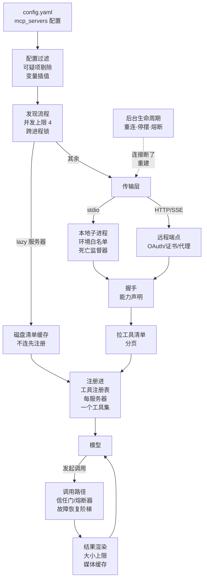

# MCP（客户端 + 服务器端）

hermes 的 MCP 支持：外部工具服务器怎么接进来、连接怎么管、调用怎么走、OAuth 怎么做，以及 hermes 反过来让自己的消息能力被别的 agent 当工具调。
本篇以 **MCP 客户端**为主线——接外部服务器是面试的主战场；hermes 当服务器一侧单独一个问题收尾。工具进注册表之后怎么组装清单、怎么路由，归《工具系统》篇，本篇只讲「怎么挂上来」「挂上来之后这条连接自己的命」和「调用怎么走」。

## 重点地图

按面试出现频率分层，时间紧就先看三星：

- ⭐⭐⭐ **必考，要能脱口而出**：Q1 全景、Q2 发现与注册、Q5 调用路径、Q6 连接生命周期
- ⭐⭐ **高频，要会讲**：Q3 传输与进程管理、Q4 OAuth、Q7 安全模型
- ⭐ **了解思路即可**：Q8 hermes 当 MCP 服务器、Q9 收尾开放题

## Q1：MCP 支持是干什么的？核心机制主要流程是什么？ ⭐⭐⭐

> **一句话：** 配置里每个 MCP 服务器，启动时连上（本地子进程或远程端点）、握手、拉回工具清单，加前缀注册进工具注册表——之后模型把它当普通工具调；连接背后有一整套生命周期管理（重连、停摆、熔断、回收），让外部进程的故障不至于变成 agent 的故障。

**主答：**

MCP（Model Context Protocol）是 Anthropic 2024 年底开源的标准协议，让 agent 用统一方式调用外部工具服务器。hermes 两头都做：**客户端**——把别人写好的工具服务器接进来；**服务器端**——一条命令让自己约 20 个消息平台的能力被别的 agent 当工具调（Q8）。

客户端的核心流程是一条「配置 → 连接 → 注册 → 调用」的流水线，看图：

顺着图走：启动时读配置文件里的服务器清单，先过滤（可疑配置剔除、环境变量引用插值），然后按并发上限分批连接（图里的「发现流程」；配了 lazy 的服务器不连，直接拿上次缓存的清单注册，Q2 追问展开）——本地服务器 (stdio) 拉起子进程，远程服务器 (HTTP) 连端点、要授权的走 OAuth（Q4）；连上后握手拿到对方的能力声明，拉回工具清单，按配置过滤、改写成统一命名，注册进 hermes 那张所有工具共用的注册表（《工具系统》篇 Q1），每个服务器自带一个工具集开关（把这台服务器的全部工具打包成一组、可整体开关）。之后模型发起的调用走专门的调用路径：先过安全和熔断检查，再转发给服务器，结果清洗、限幅后贴回对话。连接本身由后台的生命周期机制看着——断了重连、连不上停摆、坏了熔断，细节在 Q6。

### 追问：MCP 解决什么问题？协议长什么样？

解决的是工具对接的 N×M 问题：M 个 agent × N 个工具系统，没有协议时每对组合都要单独对接一次；有了协议各写一头，工具服务器写一次、所有 agent 都能挂——GitHub、Linear、数据库、浏览器都提供官方服务器，生态是现成的。

协议本身不复杂，四个要点：

1. **消息格式**：JSON-RPC，一问一答加通知；
2. **三类能力**：工具 (tools)＝模型能调的函数；资源 (resources)＝能读的数据和文件；提示词 (prompts)＝预制模板。另有服务器反向请求——借 agent 的模型生成文本、向用户要输入；
3. **三个角色**：宿主 (host)＝跑 agent 的进程，客户端 (client)＝宿主里管一台服务器的连接器，服务器 (server)＝外部工具进程。hermes 是宿主，为每台服务器开的连接就是客户端；
4. **两种传输**：stdio（本地子进程）和 Streamable HTTP（远程）。协议还在快速改版——2026 年中的新版本把 HTTP 侧改成无状态、去掉了握手，客户端得同时兼容几代，hermes 新旧都支持（Q3 追问）。

### 追问：MCP 和 function calling 是什么关系？有了 function calling 为什么还要 MCP？

叠加关系，不是替代：MCP 接进来的工具，模型照样用 function calling 发起调用——MCP 没有自己的调用表达，它补位的地方不在「怎么调用」，在「工具从哪来」。两者各管一段接口：

- **function calling 是模型侧的接口**：约定模型怎么「说出」要调哪个工具、参数是什么，输出一段结构化的调用意图，交给 agent 去执行。它不管实现放在哪——本地函数、自己包的外部 API，都行；
- **MCP 是 agent 和工具服务器之间的协议**：清单怎么发现、进程怎么拉起、连接怎么维护、凭证怎么管，全在它这边——这些 function calling 一个字都没规定。

所以「有了 function calling 为什么还要 MCP」，答案不在「本地 vs 外部」——不用 MCP 也接得了外部工具（自己把外部 API 包成工具实现就行）。分界在接入方式：自己一个一个写，工具永远只有自己维护的几个；走标准协议动态接入，工具服务器写一次、所有 agent 都能挂（N×M，见上一个追问），发现、传输、认证全是标准的。hermes 里的接合点就是那张统一的注册表：MCP 工具和内置工具汇进同一张表（怎么汇入见 Q2），模型用同一套 function calling 调它们，看不出来源差别（下一个追问）。

### 追问：工具清单里的 MCP 工具，和内置工具对模型有区别吗？

没有区别，这是设计的要点。MCP 工具注册进同一张表、走同一条调用路由、结果贴回同一份历史，模型视角完全一致；差异被收在两端——清单组装时 MCP 的参数格式要清洗成各模型服务商都接受的形状（Q2），调用路径上 MCP 多了信任门、熔断器和故障恢复这些「外部进程不可靠」的防护（Q5）。《工具系统》篇 Q1 的图里把 MCP 画成汇入注册表的一条支线，本篇展开的就是这条支线自己内部的机制。

## Q2：一个 MCP 服务器从配置到工具进清单，流程是什么？ ⭐⭐⭐

> **一句话：** 读配置 → 过滤和插值 → 挑出没连的服务器（并发上限 4）→ 连接握手 → 按能力声明拉工具清单 → include/exclude 过滤 → 统一命名、清洗格式 → 注册进注册表，同时把工具清单写进磁盘缓存。

**主答：**

启动时（以及手动刷新、配置热更新时）跑一遍发现流程：

1. **读配置**：配置文件里每个服务器一条。先过一道安全过滤——命令长得像「起个 shell 再 curl 外发数据」这种窃密形状的直接剔除（Q7）；配置里的 `${变量名}` 引用从当前档案的环境变量和密钥里插值（档案 (profile)＝一套独立的 hermes 配置和凭证，一台机器可以跑多个档案互不干扰），复制自编辑器的写法（如 `${workspaceFolder}` 指会话工作区）也认；
2. **挑候选**：已经连着的、正在连的、还在失败冷却期里的（Q6）跳过；剩下的分批连接，并发上限默认 4——细节和原因见下方追问；
3. **连接握手**：建传输（Q3）、握手拿能力声明，要授权的远程服务器走 OAuth（Q4）；
4. **拉清单注册**：分页拉回全部工具（最多翻 50 页防死循环），按配置过滤（下述追问），统一命名后注册进工具注册表，每个服务器生成一个自己的工具集。工具的参数格式在注册前清洗成各服务商都接受的形状（不合规键名重命名、缺字段补齐，细节归《工具系统》篇 Q2）；同时把整份清单写进磁盘缓存，给 lazy 启动用。
   只声明了资源或提示词能力、没有工具能力的服务器，跳过拉工具这步（协议规定这时拉工具会直接报错），只挂对应的包装工具。

每次连完打一行汇总日志，失败的服务器点名带原因——不用挨个排除哪个没连上。

### 追问：为什么要限制发现的并发？还要跨进程加锁？

两件事防的都是「同一瞬间拉起一堆子进程」：并发上限 4 防的是一台机器上的——每个 stdio 服务器连接都要拉一棵子进程树，配 20 台服务器不限并发地同时拉，内存和 CPU 瞬间冲高；超出的分批连，每批 120 秒预算、整轮封顶 300 秒，慢一点连完而不是永远连不完。跨进程文件锁防的是多进程的——网关（hermes 的长驻后台进程，管约 20 个消息平台的接入）、命令行、终端界面可能同时在跑，各自的发现流程会把同一台 stdio 服务器拉起两份；锁让同一时刻只有一个进程做发现，其他进程等它连完再检查一遍自己还缺哪些。锁本身坏了（拿不到、不可用）就退化为不加锁——协调机制不能反过来挡住工具。

### 追问：工具名怎么起？撞名怎么办？

先分清两个东西：**注册进注册表的工具名**是 `mcp__服务器名__工具名`（双下划线），两段都把字母数字下划线以外的字符统一换成下划线；**工具集的组名**是 `mcp-服务器名`（连字符），是这台服务器全部工具的打包开关——名字相似但是两回事。工具名超过 64 字符的截断、尾缀一段稳定哈希（防截断后两个长名撞成同一个）——部分服务商校验工具名长度，超长会让整个请求被拒。双下划线约定和 Claude Code、Codex 一致，保证服务器名或工具名自己带下划线也不会切错位；官方用户文档写的还是单下划线，没跟上这个改动，实际以双下划线为准。

撞名分三层处理：同一服务器里两个工具归一化后同名的（比如 `read-file` 和 `read_file`），全部拒注册而不是随机挑一个——分不清该路由给谁；hermes 自己生成的资源/提示词包装工具和服务器原生工具撞名的，保原生、弃包装；和内置工具或别的服务器撞名的，保留先注册的，后来的跳过并记日志。原则一致：宁可少一个工具，不让一个名字指向两个实现。

### 追问：include/exclude 过滤规则是什么？为什么需要？

每台服务器可配 `include`（白名单，只注册列到的）和 `exclude`（黑名单），条目支持通配符（`*_dns_*` 匹配所有带 `_dns_` 的工具），两者都有时 include 赢，include 写成空列表等于全不注册。除了裁剪上下文，这也是安全控制：给敏感服务器只开只读工具、把「删客户」这类危险操作从模型视野里拿掉。工具特别多的服务器需要它——官方文档自己举例：Cloudflare 的服务器一家就有约 3300 个端点工具，靠通配符按产品线批量关。配置裁剪之外还有一道兜底：服务器工具多到配置也裁不完时，进模型的清单层面还有「冷门工具折叠成搜索入口」的机制，那是工具系统的通用机制，归《工具系统》篇 Q3。全被滤掉的服务器不建工具集，清单保持干净。

### 追问：资源 (resources) 和提示词 (prompts) 是怎么挂成工具的？

服务器声明了这两类能力的话，hermes 给它挂四个包装工具：列资源、读资源、列提示词、取提示词，命名同前缀规则。关键是**按握手时的真实能力声明来挂**，而不是无脑挂四个：早期版本无差别注册，结果纯工具服务器上模型一调包装工具就收到「方法不存在」，还以为服务器坏了。能力声明是握手返回里的权威信息——有这个能力的子项才会出现。包装工具也能在配置里单独关掉。

### 追问：lazy 启动是什么？为什么需要？

每台服务器可配 `lazy`：启动时不连接、不拉子进程，直接用上次连接时写下的磁盘缓存把工具注册进清单；第一次真有调用时才连接。解决的是冷启动时间——一台本地服务器连上要 10 到 60 秒，配置一堆服务器但常用的就两台时，启动全部拉一遍很浪费。代价是缓存可能过期：所以缓存键是配置指纹（命令、参数、URL、过滤规则任一变了缓存作废），服务器自己声明了缓存有效期 (TTL) 的到期作废；没有缓存可用时（比如第一次连接）永远真的连一遍，连接成功就写回缓存。真连上之后，缓存里有、但服务器已经不提供的「幽灵工具」会被摘掉。状态面板把这种服务器标记为 lazy 并显示缓存的工具数——它是正常的，不是挂了。

### 追问：工具中途变了怎么办（动态发现）？

服务器可以主动发「工具列表变了」的通知，hermes 收到后自动重新拉清单、更新注册表，不用手动刷新。更新是**原地增删**而不是推倒重来：先摘掉消失的、再注册新增的，进行中的调用持有的工具名始终有效。变更会打一行警告日志，列出增了什么删了什么，让操作者留意——外部服务器动态改自己提供的工具，这件事本身值得警惕。资源和提示词的变更通知收下但暂不处理。

## Q3：本地子进程和远程端点分别怎么管？（传输与进程管理） ⭐⭐

**主答：**

每个服务器一条长驻异步任务，全挂在一条后台事件循环线程上；传输分两族，各自的讲究都在「外部进程不可靠」上。

**本地 (stdio)**：每个服务器一个子进程，通过标准输入输出对话。hermes 对子进程做了三件事：

1. **环境变量白名单**：只给安全基线（PATH、HOME 这类运行必需项）加配置里显式声明的，不继承 agent 自己的完整环境——agent 的环境里全是 API 密钥，原样传给外部代码就是泄漏；
2. **启动器托管**：配置里裸写的 npx、node、uv 这类命令，解析到 hermes 自己带的工具链上，不用用户装的——版本可控、行为可复现。万一服务器包里的原生模块是按别的 Node 版本编译的起不来，启动失败时能从它的错误输出里认出这种情况，报错直接给出「用哪条命令重编」的解法，而不是一句莫名的「连接已关闭」；
3. **恶意包预检**：用 npx、uvx、pipx 这类按包名拉起的启动方式，先查开源漏洞库 (OSV) 核对这个包名有没有恶意软件通报——只拦确认的恶意记录、普通安全漏洞不拦（用不用带漏洞的包是用户自己的取舍）；只覆盖按包名安装的启动（包管理器里有据可查），node 直启本地脚本不经过包管理器、不查。查询失败就放行（失败开放——不能因为漏洞库连不上就不用工具），结果缓存一小时防反复查询。

**远程 (HTTP)**：hermes 不让官方 MCP 客户端库 (SDK) 直接裸连，自己构造 HTTP 客户端：连接前先发一个轻量探测（拿内容类型判断这个 URL 是不是 MCP 端点——填错成网页地址的话 5 秒内报「这看着是个网页」，不用干等 60 秒超时）；代理设置按环境变量和系统配置显式重建；双向证书认证 (mTLS)、按档案注入的身份头都支持。首次用新协议 (Streamable HTTP) 连不上、报错内容像是「只认旧协议」的，自动换 SSE（旧版协议的远程传输：一条 HTTP 长连接单向往下推消息）再试一次，成功就记住，以后直接走 SSE。要 OAuth 的远程服务器授权流程见 Q4。

所有服务器的连接任务跑在同一条后台事件循环线程上——工具调用线程把请求转交过去执行、阻塞等结果，这样同步的主循环不用改造成异步就能用 MCP（《Agent 主循环与编排》篇讲过主循环为什么保持纯同步）。

### 追问：agent 进程死了，子进程怎么办？

这是 stdio 方案的经典坑：agent 被 kill -9 或崩了，子进程没死，被过继给系统 init 进程，永远挂着占内存。hermes 的答案是**共享死亡监督器**：每个 hermes 进程额外拉一个极小的监督进程，所有 stdio 服务器的进程组都登记给它；监督进程盯着一条管道，agent 一死管道断开（对端关闭，精确且零成本），它就对手里所有登记过的进程组先温和终止、等 3 秒、再强杀——不管 agent 是怎么死的。反向也管：每个子进程的进程组号在拉起时记档，正常关停走「先父进程、宽限期、再补刀」的顺序，杀进程组能连带清理被过继的孙进程。

这个设计本身是替换出来的：早期方案是每个服务器包一层看门狗进程，轮询「父进程还在吗」——一个服务器约 10 MB 内存，还最多慢一个轮询周期才反应；换成共享监督器后全部服务器合用一个约 15 MB 的进程，死亡检测从「轮询发现」变成「管道断开即知」。组号会被系统回收复用是残余风险（可能误杀一个无辜的新进程），靠「组里没活人了就注销登记」压缩窗口，文档里明说没根治。Windows 没有这套 POSIX 机制，等价物是把自己挂进系统的「随父进程关闭」任务对象，内核层面保证子进程跟着死。

### 追问：keepalive 怎么做？

远程连接默认每 180 秒发一次协议的 ping 保活——很多服务器有空闲会话过期，不主动 ping 的话，过一会儿第一个真实调用就会因为会话过期而失败。两个工程细节：有的服务器不实现可选的 ping，报「方法不存在」就记住、改用拉工具清单当保活（拉清单是只读的，有副作用风险的操作不能当保活）；保活绝不和业务调用并发——原因见 Q5 的串行追问。本地子进程默认不保活（管道没有远端会话过期问题），但可以显式配。保活失败触发重连（Q6）。

### 追问：2026 年的新协议版本，hermes 怎么兼容？

协议 2026 年中的版本把 HTTP 侧改成了无状态：删掉握手，每个请求自带版本和能力，还新增了一个「发现」接口（协议自带的版本发现接口，让服务器通告自己说哪个版本——别和上面 Q2 说的「发现流程」混了，那是 hermes 连服务器拉工具的整条流水线）。hermes 的协商策略是**先老后新**：默认先发老式握手（存量服务器零额外开销），被拒且拒绝理由是「只认新协议」才换新的发现流程；配置可以强制指定模式。注意这是握手版本的协商（旧→新），和上面传输层的新→旧回退是两个维度——一台服务器完全可能传输只认旧 SSE、握手却只认新协议。还有个兜底分支：服务器好好应答了握手、只是它报的协议版本客户端不认、又没有新版发现接口的——hermes 按自己刚才发出的那个版本把握手流程走完：这个版本服务器刚刚证明过能接受，比因为版本号谈不拢就踢掉一台能用的服务器强。工具清单分页还认新协议给的服务器端缓存提示（就是 Q2 lazy 启动说的缓存有效期 TTL），存进磁盘缓存。

### 追问：官方 SDK 不是把协议都给好了吗？为什么外面还要包一层？

SDK 管的是协议本身——消息编解码、握手、OAuth 的标准流程；但协议之外全是工程问题：子进程的生老病死、凭证落盘和跨进程竞态、故障恢复、各家服务器的差异、结果限幅。hermes 的包法是把 SDK 当一个可选的库用：没装 MCP 包就整体降级成「没有 MCP」，装了也要真用到才导入（导入本身要花几百毫秒，启动时白付不值）；传输层自己构造客户端、进程自己监督、故障自己管（Q6）。可以说 MCP 接入的难度大头从来不在协议，在「把一个不受你控制的进程当靠谱组件用」——SDK 不管这半截。

## Q4：远程服务器的 OAuth 怎么做？ ⭐⭐

**主答：**

远程 MCP 服务器大多要求 OAuth 2.1 授权（Linear、Notion、Cloudflare 这些托管服务）。首次连接时 hermes 发现要授权，就走标准浏览器流程：发现授权服务器的元数据（端点在哪）→ 注册客户端身份 → 弹浏览器让用户登录授权 → 本地回环端口接住回调 → 换取令牌存盘（用户目录下、仅本人可读的权限）→ 之后带着令牌调工具、过期自动刷新，全程无感。令牌分两种：访问令牌短命、每次请求带着用；刷新令牌长效、专门用来换新的访问令牌。

hermes 在 SDK 标准流程之上补五件事，其中刷新栅栏和无头环境两个在追问展开：

1. **客户端身份自动注册**：优先用客户端身份文档 (CIMD)——client_id 本身是一个 https 网址，指向一份公开的客户端元数据，服务器自己来取，零注册；服务器不认就退回动态客户端注册 (DCR)。协议 2026 年版已把 DCR 标为弃用、推荐 CIMD，hermes 的默认顺序就是这个方向；
2. **令牌落盘带签发方绑定**：过期时间存绝对时刻（存相对秒数的话重启后死令牌会复活成「还有效」）；刷新令牌记着是哪个授权服务器发的，签发方变了（服务器迁移、元数据被改）就作废不发过去——把长效凭证交给新的签发方等于送钥匙；
3. **跨进程刷新栅栏**：一把跨进程文件锁圈住「读令牌 → 换新 → 落盘」全程，防两个进程烧掉同一张刷新令牌（下述追问）；
4. **无头环境交互抑制**：浏览器流程只在有人守着的环境里启动，后台路径永远不弹浏览器（下述追问）；
5. **厂商坑位修复**：个别厂商不按标准来——不发刷新令牌、拒绝不带 User-Agent 的请求、声明了签发方回传校验却不回传，逐个补上。

### 追问：刷新栅栏防的是什么？

单次使用的刷新令牌有个跨进程竞态：网关和命令行两个进程同时读到同一个旧刷新令牌、都去换新——先到的成功，后到的拿着已作废的旧令牌再发一次，把刚换出来的新令牌也烧掉（部分服务商的刷新令牌一次一换，旧的一用就整体作废），用户被登出。hermes 用一把文件锁把「读令牌 → 发请求 → 新令牌落盘」整个圈起来，同一时刻只有一个进程在刷新；等锁的进程醒来先查磁盘，发现同伴已经换好了就直接采用，绝不把自己手里那份（可能已作废的）发出去。拿不到锁就放弃本次刷新——宁可这次失败，不能烧凭证。

### 追问：服务器上没有浏览器，怎么完成授权？

hermes 判断「有人守着」的标准是标准输入连不连着真终端；网关、后台自探测这类没终端的路径**永远不弹浏览器**——弹一晚上授权页是真实出过的事故。无头机器完成授权的途径：终端里跑登录命令时，把打印出来的授权网址在本地浏览器打开、再把跳转回来的网址粘回去（回调收不到没关系，授权码就在网址里）；或走设备码流程（在任意设备输个短码、hermes 轮询等批准）；或把回调端口用 SSH 隧道转回本机。

### 追问：访问令牌过期、刷新令牌也坏了，运行中怎么恢复？

工具调用收到 401 时：先查磁盘上的令牌文件是不是被外部更新过（别的进程或人工登录刚换过——按文件修改时间判断），是就直接采用重试；否则看能不能原地刷新，能就刷新、重建连接、把刚才那个调用重试一次——401 是请求被对方的授权层挡在操作执行之前，操作本身没发生，重试安全。多条并发调用同时 401 的按失效令牌去重，只触发一次恢复。全都救不回来就返回一条结构化的「需要重新授权」错误，明确告诉模型**别再自己试了、去叫用户**——不然模型会固执地重试到熔断。

### 追问：注册的客户端身份也会失效？

会：服务器端把注册删了或配置错了，令牌端点会回「客户端无效」。hermes 盯着令牌端点的这类应答，确认后把缓存的客户端注册删掉（留备份），下次自动重走注册；用配置手工指定 client_id 的不算——那是配置错误，自动删了重注册也救不了，报出来让人改。

## Q5：模型调用一个 MCP 工具，具体走什么路径？ ⭐⭐⭐

> **一句话：** 信任门（不可信服务器的写工具先要审批）→ 熔断器检查 → 拿活连接（lazy 启动的服务器此刻才连）→ 后台事件循环上发 RPC（每台服务器串行、带超时）→ 失败走恢复阶梯 → 结果清洗限幅后以 JSON 贴回历史。

**主答：**

模型照常发起工具调用，路由到注册表里对应的处理器后，MCP 专属的调用路径开始：

1. **信任门**：服务器配成不可信 (untrusted) 的，写能力的调用先弹审批——用户批了才放行（Q7 详述）；
2. **熔断器**：该服务器处于熔断期就直接返回错误，不再发请求（Q6）；
3. **拿连接**：查这台服务器的活连接——lazy 启动的服务器此刻才真正连接，已回收的此刻唤醒，正在重连的最多等几秒；都没有就返回「未连接」并顺手触发重连；
4. **执行**：调用被转交到后台事件循环线程，对服务器发出协议调用，超时默认 300 秒（每台可配）。**每台服务器一次只跑一个请求**（为什么串行见下方追问）；正在执行的调用和子进程存活监视赛跑：子进程死了立即失败，不陪着等满超时。失败按类型走恢复阶梯——哪些能重试有严格规则，见 Q6 的「至多一次」追问；
5. **渲染结果**：内容清洗和限幅（下述追问）后包成 JSON 贴回对话历史，走《工具系统》篇的标准预算控制。

一到四步都是 MCP 专属的，其中 1、2、4 是「外部进程不可靠」加的防护；第 5 步里只有清洗限幅是 MCP 自己的，清洗完就并回《工具系统》篇的标准路径。

### 追问：结果怎么清洗和限幅？

服务器返回的内容块按类型分五种待遇：

1. **文本**直接过（先做一道隐形字符清洗，见 Q7）；
2. **图片和音频**不进对话——解码后存到媒体缓存，历史里只放一个文件路径标记，消息平台渲染时再把图挂出来，省 token 也不丢内容；
3. **资源块**物化——嵌着内容的直接取出，二进制的大块（上限 50 MB）落盘成文档、给个路径，只是个链接的给个「用读资源工具去取」的指针；
4. **不认识的块类型**不静默丢——塞一条「某类型内容被丢弃」的说明进结果，模型才知道少了东西、能想办法补；
5. **结构化内容** (structuredContent) 保留，附带的 `_meta` 元数据字典（厂商自定义的附加信息）也透传给模型——但键名以协议保留前缀开头的删掉，那是协议管道信息不是给模型看的，删完空了就整个不附；结构化内容和某个文本块解析后内容相同的那份去掉——协议建议服务器两处都发兼容旧客户端，都转给模型就是双倍 token，空格、键序不一样也算同一份。

限幅两道：整个文本结果有 200 万字符的硬顶，超了保留开头和结尾、中间塞一段截断说明——正常大结果走《工具系统》篇的预算层溢出落盘，硬顶只兜恶意灌水；错误文本里长得像凭证的串（API key、Bearer 令牌）统一打码再给模型。

### 追问：为什么每台服务器串行？能并行吗？

串行的原因是 stdio 只有一条消息流：请求按先后排队走，一个请求没回完另一个插进去，实测会楔死正在等响应的调用（记载的原始事故是并发拉清单楔死了一个工具调用）——所以同一台服务器一次只发一个请求，保活也得排队等（Q3 的保活不并发就是这个原因）。远程端点技术上能并发，但保持同一连接上请求的先后顺序更稳，也和 stdio 行为统一。想并行的话每台服务器可配「支持并行调用」，它的工具就能进模型一次请求里那批调用的并行执行组，和内置只读工具一起并发（《Agent 主循环与编排》篇 Q6 的批次编排）。默认关，因为 hermes 无法替服务器判断它的工具并发安不安全——两个工具写同一个文件就是竞态，开关交给配置的人，配置项名字本身就是提醒。

### 追问：elicitation 是什么？

MCP 的反向请求之一：服务器在工具调用中途向用户要结构化输入（「要迁移到哪个空间？给个选项表单」）。hermes 把它接到自己的审批通路上——终端里是交互提示，Telegram、Slack 这类消息平台上是审批按钮，请求到达用户所在的任何界面；默认等 5 分钟（和 hermes 自己审批机制的默认等待时长一致），超时或出错一律回绝、绝不默认同意。链接模式的 elicitation 要把用户带去外部网址操作、协议上还需另一个结果回传环节，hermes 没实现这条链路，直接回绝。

### 追问：sampling 是什么？

服务器反向借 hermes 的模型用：「帮我总结这段文字」。hermes 默认允许（服务器经常需要模型能力但自己没有 key），每台服务器可配限流：默认每分钟 10 次（滑动窗口）、单次 30 秒、最多 4096 token、可锁允许的模型名单。被借的模型还能在这次生成里发起工具调用——服务器把自己的工具随请求附上来，模型说要调哪个、服务器执行了带着结果回来继续生成，这个来回最多 5 轮，防服务器借模型跑无限循环。请求走辅助模型通道（和主对话隔离），每次都记审计日志。这个特性协议已标为弃用方向，hermes 保持兼容不扩展。

## Q6：连接断了怎么办？（生命周期：重连、停摆、熔断、回收） ⭐⭐⭐

> **一句话：** 分层兜底——单次调用内的恢复阶梯（换凭证重试、重连重试、子进程复活）→ 连接级重试预算（带抖动的退避，防反复拉起）→ 停摆（摘工具、定时自探测、任务永不退出）→ 失败冷却和熔断器把故障服务器隔离在外；闲太久的连接主动回收、工具保留。

**主答：**

外部进程和远程端点迟早出问题，hermes 给每个服务器一个长驻状态机：连接中 → 已连接；中途出问题先降级（带着退避重连），修不好就停摆，停摆后探测到恢复再复活，如此往复。逐层看：

1. **调用内恢复**：单次工具调用失败，先按失败类型走恢复阶梯——授权过期就刷新凭证重试一次，会话过期就重建传输重试一次，本地子进程死就拉起新的再试（哪些能重试有严格规则，见下方「至多一次」追问）；恢复不了才变成返回给模型的错误；
2. **连接级重试**：传输层断了带着抖动的指数退避重连（1 秒起步翻倍、上限 60 秒，±20% 抖动——多台服务器同时掉线重连时，不至于同一频率反复打对方），初次连接最多 3 次。已连上之后掉线的，有 5 次的重连预算。这里有个关键概念「**证明过的会话**」：握手成功不算健康，只有扛过一整个保活周期、或成功服务过一次调用才算；这笔预算烧完（连续 5 次没证明过就断）直接停摆——防的是「握手完就断」的抖动连接无限拉起（真实事故：63 小时拉起六千多次）；
3. **停摆 (park)**：重试预算耗尽或遇到确定性失败（凭证吊销、端点没了——这类失败重试必然同样结果，不进重试阶梯），把这台服务器的工具从注册表摘掉、连接任务原地等待——每 5 分钟自己探测一次能不能复活，授权恢复、手动刷新会立即唤醒。任务**永不退出**：它是唯一监听「重连」事件的实体，退出了这台服务器就永远叫不醒了。停摆期间的自探测**绝不弹浏览器授权**——后台没人守着（Q4 讲的事故）；
4. **冷却与熔断**：注意这两个不在上面的状态机里，是发现侧和调用侧的两本独立账。连不上就进入失败冷却（30 秒起指数翻倍、上限 10 分钟），冷却期内发现流程不再碰它——网关上每个对话会话各自初始化一遍工具（每个都跑一遍发现），没有冷却的话一台坏服务器会被几秒一次地反复拉起，拖垮同机的健康服务器。调用侧另有熔断器：连续 3 次调用失败就熔断 60 秒，期间对该服务器的调用直接返回错误、错误文案明确告诉模型「别再重试，换路或找用户」——模型不知道熔断器的存在，只会执着地重试到把整轮对话烧掉（真实事故：90 次迭代）。

服务器复活或故障恢复，工具重新注册回注册表，模型下一轮又能看到——对模型来说工具清单是轮次级更新的（《工具系统》篇 Q2）。

### 追问：停摆的服务器怎么活过来？删掉配置的还会探测吗？

三条路：定时自探测（每 5 分钟自己连一次）；外部授权（操作者跑一次登录命令、或在桌面客户端上点一下授权，令牌落盘后连接任务会被叫醒）；手动刷新命令。自探测有一条规矩：磁盘配置里这条已经删了或禁用了，自探测就地暂停——否则它会拿着启动时拷贝的旧配置，每隔 5 分钟为一个用户已经不要的服务器重跑一遍包括 OAuth 初始化在内的整套流程，跑一整晚。停摆日志也做了防刷屏：同一个原因反复停摆，只有第一次打警告，之后降为调试级。

### 追问：为什么「握手成功不算健康」？

因为故障分两种：环境性的（网络断了、服务重启）和结构性的（服务器起来就崩、握手完立刻断连接）。前者重试有意义，后者重试只是烧资源，得区分对待。判据就是「证明过的会话」：新连接默认带预算，只有真用过——扛过保活周期或服务过调用——才清零。握手本身是零成本的应答，抖动型故障恰恰是握手每次都成功、随后就断；不看「证明」只看「连上过」，这类服务器会永远重连下去。本地子进程没有保活时，「闲置满一个默认保活周期且子进程还活着」算证明。唯一例外：一直健康的服务器突然报授权错误，先破例强试一次重连再停摆——长期健康突然 401 更像凭证竞态（Q4 刷新栅栏防的正是这类）而不是吊销，一次重连的代价远小于误停摆后等人工。

### 追问：写操作重复执行怎么办？——「至多一次」语义

恢复阶梯里的「重试」只对**确定没发出去**的调用安全。授权失败 (401) 是请求被对方的授权层挡在操作执行之前，操作没发生，随便重试；但「会话过期」「传输中断」这类失败可能发生在请求已经到达服务器、只是响应没回来之后——重试一个写操作（转账、建工单）就是重复执行。所以规则是：**只有服务器声明了只读的工具才自动重试**，写工具遇到这类失败一律不重放，返回一条「结果未知：操作可能已生效，先用只读工具核实再决定」的错误，让模型去查证而不是再按一次。本地子进程的死亡同理，判定依据是时间点：调用开始前先检查子进程还活着吗（死了就是没发出），拉起新进程补发一次；调用进行中有个 250 毫秒一轮的监视协程和调用赛跑（它先报死，就是发出之后死的），结果未知、绝不补发。只读与否看服务器在工具上的声明，没声明的按写处理——宁可多问一次，不冒重复执行的险。

### 追问：内存大户怎么治？——空闲回收

浏览器类的 MCP 服务器第一次调用后会常驻几百 MB。每台服务器可配空闲超时和最长寿命：到点的连接被主动拆掉，但**工具保持注册**，状态记成「已回收」；下次调用发现没有活连接，15 秒内重新拉起再执行——对模型只是每次闲置后的头一次调用慢几秒。计时上，有调用进行中就暂停空闲计时，干完活重新数——不会拆掉正在干活的连接。

### 追问：改了配置要重启吗？

不用，两条热更新路：会话里敲刷新命令重载全部 MCP 服务器；长驻网关自己盯着配置文件，约一分钟内把删掉的、禁用的拆掉、新加的连上（多档案网关按档案各管各的）。首次连接失败的服务器修好病因后不用动任何东西——冷却期一到，网关定期把配置和实际连接对一遍账，发现配置里有、连接里没有的就重试它。

### 追问：业界其他主流的做法是怎样的？

三家主流的实现：**Claude Code** 对远程连接断了做指数退避重连（最多 5 次），提供手动「全部重连」命令和面板操作，工具输出超限（默认 2.5 万 token）先告警再截断；**Cursor** 官方文档只承诺「故障隔离到单个服务器」加界面上手动重试；**Codex CLI** 定义了启动超时和「服务器可选还是必需」的启动语义，运行中崩溃后的机制未公开。共同点：生命周期管理都集中在**连接建立阶段**，运行中的自愈深度普遍不文档化。

hermes 的差异是把「活着」当成一个持续管理的问题——上面这四层加 Q3 的进程监督就是它的答案，每一层都对应一类真实故障；代价是状态机复杂，停摆原因、预算计数、回收原因各是一份状态、各记各的账。讲面试时这是好素材：能说出「我知道这些机制各自防什么事故」，比背一张特性清单有说服力得多。

## Q7：接一个外部工具服务器，防什么？（安全模型） ⭐⭐

**主答：**

接外部工具服务器，等于**在自己机器上跑别人的代码**＋**把别人给的内容喂给自己的模型**——两个攻击面，配三道闸：配置闸、进程闸挡第一个面，内容闸挡第二个面。

**第一道：配置闸**（防配置被做手脚——配置文件可能被诱导写入恶意条目）：存盘和拉起时都跑一遍形状检查——命令里出现「起解释器再 curl/wget 外发」的、往 SSH 授权键、计划任务、sudoers 这类系统持久化位置写的，直接拒；另有一份来自真实攻击事件的固定指标黑名单（2026 年中一次利用 hermes 公开实例的攻击里攻击者用的 SSH 公钥、源 IP），手工埋进配置文件也会被拦。

**第二道：进程闸**（已经连接的服务器代码本身不可信）：环境白名单、托管工具链、恶意包预检、死亡监督——都在 Q3 讲过，共同思路是外部代码默认拿最小权限跑、死了必须能收尸。运行时再加一层**信任分级**：服务器配 `trust: untrusted` 后，所有**写能力**的调用（判定依据是发现时抓下的只读标注，没标注的算写）在发出前先过用户审批，批一次放行一次；配错值（拼错单词）一律按不可信处理——配置打错字不能把门打开。分级判定用发现时抓下的本地数据快照，不在调用时重新读服务器给的信息，也不改工具的参数格式——工具清单一个字节不动，提示词缓存不受影响（《上下文工程》篇的缓存不变量）。

**第三道：内容闸**（防喂给模型的内容做手脚）：工具描述和结果文本先剥一层**隐形字符**——Unicode 标签区字符在终端和聊天界面上不可见、对模型却完全可见，是往提示词里夹私货的经典信道，从源头剥掉（有的国旗 emoji 本身就是拿这类字符拼的，剥的时候保住了它们）；工具描述另跑一遍注入模式扫描（「忽略之前所有指令」这类），命中只告警不拦截——误报会把正经服务器判死，取舍是告警给人看。结果侧的限幅（200 万字符硬顶、资源 50 MB）防的是拿超大 payload 灌爆上下文；错误文本打码防凭证顺着报错泄漏给模型再泄漏进对话。

给了一台恶意服务器完全信任（默认值）的话，运行时这道门就只剩内容闸——所以装来源不明的服务器前，先读一遍它的安装说明文件（声明这台服务器要跑什么命令、装什么依赖的那份描述文件，官方目录里每台都带）。

### 追问：只读标注是服务器自己声明的，它撒谎怎么办？

对，`readOnlyHint` 是服务器自愿标的，撒谎可以把写工具标成只读、从而跳过审批。这道门针对的是误操作，不是恶意欺骗：操作者把一台服务器配成不可信时，已经被明确警告过它的任何调用都可能越界；自称只读的调用不弹审批，本就在他接受的范围内——撒谎能跳过的只是那一次审批，不能扩大权限（审批门之外没有它能碰到的东西：它拿到的环境变量、进程能力都已经被进程闸限死）。真要防声明撒谎，得靠服务器的行为审计，那是另一个量级的工程，hermes 选择了在「声明不可靠」的前提下设计门的位置。对比：Codex CLI 有每工具的审批模式配置，思路相同（按工具粒度配置人工门），hermes 的差异是按「只读标注＋信任级」自动分类，不用逐工具手配。

### 追问：多个档案 (profile) 共用一台机器，MCP 连接会串吗？

不会，这是显式修过的隔离：所有连接账本按「档案＋服务器名」记键——两个档案配了同名的服务器但凭证不同，就是两条连接，互不遮挡；一个档案想**共用**另一个档案已经建好的连接（同名且路由、凭证、证书逐项一致才算同一个端点身份），可以「收养」，但信任级各记各的——不可信的档案收养了完全信任档案的连接，写调用照样要过自己的审批。OAuth 凭证永远不共享：令牌在各自档案的目录里，收养判定也把 OAuth 排除在外——用别人的身份调工具，日志和权限就全乱了。

## Q8：hermes 自己当 MCP 服务器是怎么回事？ ⭐

**主答：**

场景：你在用 Claude Code 写代码，想让它「跑完测试把结果发到我 Telegram」——hermes 当 MCP 服务器就是干这个的：一条命令启动一个 stdio MCP 服务器，10 个工具把消息平台的会话能力给任何 MCP 客户端当工具调——列会话、查会话、读消息、取附件、轮询事件、长等事件、发消息、列频道，加两个审批工具。在对方的 MCP 客户端配置里把 hermes 注册为 stdio 服务器（对方负责进程的生老病死）。

读写分离实现：**读操作直接查共享状态库**（网关不在也能用——会话和消息本来就持久化在 SQLite 里），后台线程每 200 毫秒轮询一次数据库找新消息（先看文件修改时间，没变就跳过，轮询近乎零成本），新消息进内存队列，外部 agent 拿游标（「上次读到哪」的指针）增量取或长等；**写操作（发消息）走网关的发送引擎**——平台连接只在网关里活着，所以发消息需要网关在跑。工具接口是照着同类产品 OpenClaw 的「频道桥」做的，从那边迁移过来的 agent 提示词不用改。

### 追问：审批桥那两个工具能用吗？

表面在、实际没接线，先说明白这个边界。设计上事件桥会产生「审批请求」事件、外部 agent 能列出来并代答（批准/拒绝），但当前代码里没有任何路径产生审批事件，所以列审批永远返回空、代答永远报「找不到」。工具注册了、描述也写了，管道中间那段没建。读消息、发消息这些主链路是完整可用的。

### 追问：为什么只做 stdio、不做 HTTP？

主战场在客户端不在服务器端：hermes 已经能连任意 stdio 和 HTTP 的 MCP 服务器（本篇主体），自己对外提供工具的需求（给本机的编程 agent 当消息桥）stdio 够用——客户端配置一条命令就接上。真要让远程的客户端连进来，前面加一层 HTTP 适配器即可，不值得为此在核心里养一套 HTTP 服务器生命周期。

## Q9：这套 MCP 客户端设计，最大的代价是什么？让你改你会改哪？ ⭐

**主答：**

最大的代价不是性能也不是复杂度本身，而是**故障状态的多头管理**。现在「这台服务器现在什么状态、下一步该不该碰它」散在四套机制里：连接任务自己的状态机（连接中、已连接，中间的降级重连和停摆）、失败冷却（发现流程看）、熔断器（调用路径看）、怀疑标记——各自有各自的重置条件，互相之间靠约定而不是靠一个统一的状态源。每套机制单看都对（都对应真实事故），但组合行为已经难推演；最典型的证据是怀疑标记本身：一些竞态会把连接标成可疑，设计上该在下次调用前做健康检查，但这条检查在当前版本根本没接线——标记打了没人读，恢复实际靠打标路径顺带触发的重连。一套机制复杂到自己内部的环节都能断线而不被发现，就是补丁摞补丁的直接后果。

要改就改这里，方案具体：把「健康判定」收敛成一个显式状态对象，四套机制全部改为对它读写——停摆、冷却、熔断都变成这个状态上的判定函数而不是独立账本。动一次的代价：调用路径和发现路径各改一处入口、十几处状态读写点搬家，回归风险集中在连接恢复的场景（测试里都有真实事故编号可对照）；换来的是以后加任何新故障处理只需实现一个状态转移，不用再想「我的新计数器和那四套账本怎么互斥」。相比「再加一层兜底」，这才是治本的那一刀。
