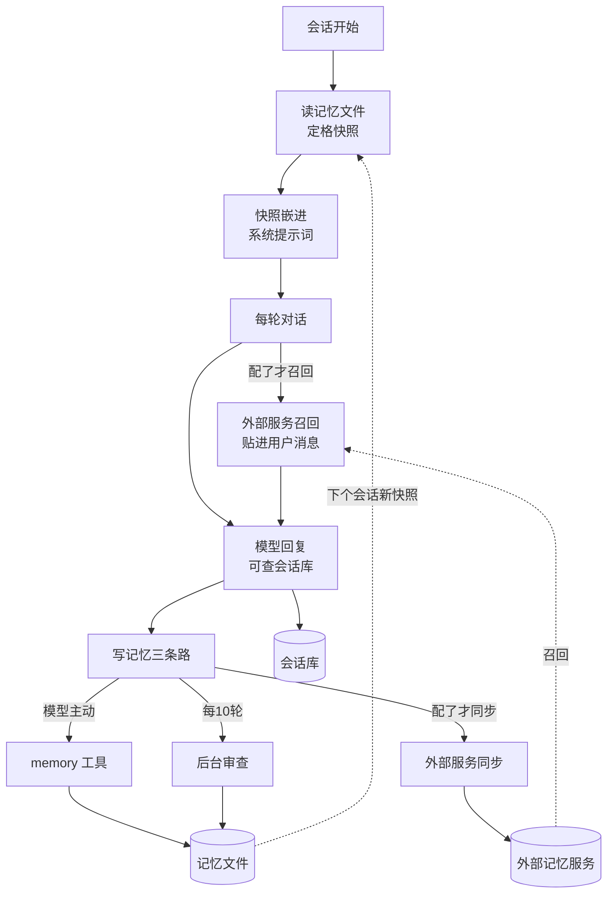

# 记忆系统

hermes 的跨会话记忆：内置记忆文件存什么、怎么进上下文、怎么写入、怎么自动写入，
以及可选的外部记忆服务 (memory provider) 和会话历史检索。本篇以内置记忆为主线
（存什么 → 怎么读 → 怎么写 → 怎么自动写），外部记忆服务和会话历史检索作为另外两块依次展开。
记忆快照嵌进系统提示词的分层细节回指《上下文工程》篇 Q2；技能 (skill) 的自动创建归《自我改进闭环》篇，
本篇只在「什么知识进哪里」的分工处点名。

## 重点地图

按面试出现频率分层，时间紧就先看三星：

- ⭐⭐⭐ **必考，要能脱口而出**：Q1 全景、Q2 存什么、Q3 记忆进上下文、Q4 怎么写入、Q5 自动记忆、Q9 概念辨析
- ⭐⭐ **高频，要会讲**：Q6 外部记忆服务、Q8 会话历史检索、Q10 业界对比
- ⭐ **了解思路即可**：Q7 七家服务怎么选、Q11 开放题

## Q1：记忆系统是干什么的？核心机制主要流程是什么？ ⭐⭐⭐

> **一句话：** 三块——内置记忆文件（小预算的固化事实，每轮全文注入提示词）、外部记忆服务（可换单选插槽，检索式召回）、会话历史检索（全量对话落库后按关键词查）；内置文件的写入一半靠模型主动调工具、一半靠后台自动审查，外部服务另有自己的每轮同步。

**主答：**

模型本身没有记性，会话一关什么都忘。记忆系统就是让 agent 跨会话积累经验的，hermes 把它分成三块：

1. **内置记忆文件**：两个纯文本文件——MEMORY.md（agent 自己的笔记：环境、惯例、教训）和 USER.md（用户画像：身份、偏好、风格）。内容有硬字符预算（两个文件合计三千多字符），会话开始时整个读出来嵌进系统提示词，每轮都在场。写它靠模型调 memory 工具，加上每十轮一次的后台自动审查；
2. **外部记忆服务**：配置里指名一家（mem0、honcho 这些），每轮开始把和当前话题相关的记忆检索出来，贴进当轮的用户消息。适合存大量对话原文、做语义检索这类重活；
3. **会话历史检索**：所有对话全文落 SQLite 库，模型随时可以调检索工具查过去的会话，不用预先提炼。

数据流是个闭环：读（快照进提示词、召回贴消息、查会话库）→ 用 → 写（工具、后台审查、服务同步）→ 存进库 → 下个会话读到的就是新内容。

### 追问：为什么要三块？一块不够吗？

三块对应三种不同性质的内容，硬塞一块会两头不讨好。固化事实（「用户说中文」「部署前要跑检查」）必须每轮在场才起作用，但只能小，所以走全文注入；大量对话原文和语义检索重，不该每轮背着走，所以外置成可换的服务；「上上周聊过什么」这种偶发查询，根本不该预先加工，落库后按需查就行。块与块的分工规则写进了提示词（Q2 展开），模型该存哪块是明确指引过的。

### 追问：会话历史也算记忆吗？

广义算——都是「过去的东西影响现在的回答」。但机制上要分开讲：记忆文件是**提炼过的固化事实**，字符预算卡着，进提示词；会话库是**全量原文**，不进提示词，查回来的是工具结果。面试里把这两个层次分开说，比笼统说「有记忆」专业得多。

## Q2：内置记忆存什么？两个文件怎么分工？ ⭐⭐⭐

> **一句话：** MEMORY.md 存环境侧事实（工具怪癖、项目惯例、路径端点），USER.md 存用户侧事实（身份、偏好、风格）；一个写给 agent 自己看，一个描述用户是谁。

**主答：**

两个文件按「事实描述谁」分工：

- **MEMORY.md（agent 笔记）**：agent 工作环境里的事实——某个工具的怪脾气、项目的老规矩、常用的路径和端点。典型用途是「下次干活别再踩同一个坑」；
- **USER.md（用户画像）**：用户是谁——名字、角色、沟通偏好、对产出形式的习惯。典型用途是「每次回答都该贴合这个人」。

两个文件预算独立（默认约 2200 和 1375 字符）、开关独立（可以只留用户画像）。这个分工不是随手定的——后台自动审查往里写事实时，有配套的「每个事实二选一」路由规则兜着（Q5 展开）。

### 追问：什么该进记忆，什么不该？

提示词里写了明确的三分法，这是记忆设计的核心：

1. **每个会话都用得上的事实**（不管当时在干什么）→ 记忆文件。「用户说中文」「服务器在哪个路径」；
2. **做某类任务时才用得上的经验**（流程、坑、用户对这类产出的偏好）→ 技能 (skill)，按需加载，不占常驻预算。技能机制归《自我改进闭环》篇；
3. **一周内就会过时的东西**（任务进度、临时决定）→ 会话历史，别固化。

还有一条写法规则：条目要写成陈述句（「用户偏好简短回复」），不写成给自己的指令（「永远简短回复」）——指令式写法在之后的会话里会被当成必须执行的命令，压过用户当场的最新要求。

### 追问：为什么分两个文件，不合成一个？

两类事实的用法不同，分开才能独立控制。画像和笔记的更新频率、该不该单独禁用都不一样：有的部署只想要「记住用户偏好」不要「agent 自己记笔记」，两个开关独立关掉就行；后台审查给事实路由时也需要一个明确的去处，一个混装文件没有判断依据。

## Q3：记忆怎么进上下文？每轮都带吗？ ⭐⭐⭐

> **一句话：** 会话开始时从盘上读出全文、定格成快照嵌进系统提示词，之后整个会话逐字节不变；中途写的新记忆只落盘，要等下个会话（或本会话压缩重建提示词时）才进提示词。

**主答：**

会话开始时把两个文件整个读出来，定格成一份快照，嵌进系统提示词尾部（系统提示词的分层结构归《上下文工程》篇 Q2）。之后每轮发请求，这份快照逐字节原样带出去——每轮都在场，但内容不变。

写入是另一条路：模型调 memory 工具，改动立刻落盘，但**不回头改提示词里的快照**。新内容要等两个时点才进提示词：下个会话启动重新加载；或者本会话触发上下文压缩时——压缩会顺带重建系统提示词，重建就是重新读盘，新写的记忆这时就进来了（压缩本身的机制归《上下文工程》篇 Q5）。所以「写入生效」的准确定义是落盘即持久、进提示词要等重建。

### 追问：为什么写入不立即生效？这不是 bug 吗？

是刻意的，为的是提示词缓存 (prompt caching)。服务商的缓存按前缀匹配：请求开头跟上次完全一致，相同的前缀部分就按缓存价计费、还免掉重新处理的时间；改一个字节，缓存从这个字节起全部作废。系统提示词在请求最前面，它一动，整个会话攒的缓存每轮都白费——钱和延迟两笔代价。这是 hermes 的全局约束「会话中途不改系统提示词」在记忆上的体现，代价是记忆生效延迟到下个会话（完整因果链见《上下文工程》篇 Q3）。

### 追问：那当前会话知道自己刚写了什么吗？

知道。写入的工具结果就在对话历史里，模型看得见自己写了什么、写入是否成功；只是提示词里那份快照是旧的。压缩也丢不了刚写的内容：压缩重建提示词时会把记忆文件重读一遍，新写的记忆以全文进新快照；真正被摘要掉的只是对话历史里那次写入的记录——「我这次存了什么」的痕迹没了，但东西在。压缩做摘要用的提示词里还专门写了一句「系统提示词里的 MEMORY/USER 是权威版本，摘要不得取代」，防的就是模型拿摘要里的转述压过提示词快照。

## Q4：记忆是怎么写进去的？ ⭐⭐⭐

> **一句话：** 单一 memory 工具，三个动作（加、整条替换、删），可合成一次批量提交；替换和删除靠一段定位文字认出旧条目、新内容整条覆盖；字符预算卡总量，超了就拒绝并附上现有条目，让模型在同一次批量调用里删旧腾地方再加新的。

**主答：**

模型调一个叫 memory 的工具写记忆，动作就三个：

- **add**：追加一条。会触发预算检查（见下）；
- **replace**：整条替换。给一段文字定位旧条目（必须只匹配到一条，匹配到多条会报错），新内容是**完整的新条目**——不是只替换定位的那段文字，是整条重写；
- **remove**：删掉定位文字匹配到的那条。

三个动作可以组成一个批量 (batch) 一次提交，**整批原子**：任何一步失败，整批不落盘；预算只看全部执行完的最终总量——所以「删两条旧的、加一条新的」能在一批里完成，哪怕中间状态超预算。

预算是硬的：两个文件各自有字符上限（默认约 2200/1375）。add 会超限被拒绝，拒绝消息里附上全部现有条目和用量，让模型自己看着办——整理记忆是模型的事，不是系统偷偷截断。

### 追问：满了之后模型整理不动、反复失败怎么办？

超限时 add 被拒是给模型的重试指引，但模型可能定位文字匹配不上条目、替换后又超、来回打转。所以每轮有一个失败计数：连续失败三次后，第四次直接返回「本轮先别存了，继续回复用户」的终态结果，让记忆这个支线永远压不过用户的主任务。一次成功写入会清零计数。另外批量整理有条专门的保护：一批不允许把文件里的条目删光——真想清空就一条条删，防止「整合」一把抹掉全部记忆。

### 追问：多个进程同时写这个文件，怎么不写坏？

记忆文件是多进程共享的——网关进程、CLI、桌面端可能同时活着，都对着同一份记忆文件（hermes 支持一个用户建多套档案 (profile)，每套有自己的记忆文件，多档案的机制归《总体架构》篇；这里说的是同一套档案内的并发）。保护是文件锁三板斧：

1. **先抢锁，再动手**。锁不在记忆文件上，在旁边一个专门的锁文件上——MEMORY.md 旁边有个同名的 .lock 文件，内容永远是空的，存在的作用就是给进程当抢锁的对象。谁要写记忆，先向操作系统申请这个锁文件的排他锁：一个进程拿到了，别的进程只能等它改完、放锁，才轮得上自己，「读—改—写」整串动作因此不会交错。
2. 改动前**在锁内重新读盘**——用盘上最新状态做底，不信任自己内存里的旧副本；
3. 写入用「临时文件+改名」：新内容在旁边的临时文件里写好，最后一步改名顶替——这一步是原子的，记忆文件这个名字瞬间从旧内容切到新内容，别的进程永远读不到写了一半的文件；旧文件也不需要单独删，改名顶替的同时它就从名字上摘掉了，磁盘空间由文件系统收回。

### 追问：为什么不直接锁住记忆文件、原地改写？

那样写和写之间确实不打架了，但会丢掉两层保护——而这两层正是「临时文件+改名」存在的理由。

一是**崩溃窗口**：原地改写是两步——先清掉旧内容、再写入新内容，中间任何一刻崩掉（进程崩、断电、磁盘满），文件就停在「旧的没了、新的没写完」的中间态，最坏整个文件废掉。临时文件+改名防的就是它：新内容先在旁边完整写好，最后一步改名——改名在文件系统层面是原子的，文件名字的指向瞬间切换、不存在切到一半。

二是**锁管不住不抢锁的读者**：操作系统的文件锁是建议锁 (advisory lock)，只在大家都去抢时才互相看得见——而读路径恰恰不抢锁，新会话启动加载记忆就是直接打开就读。原地改到一半时，另一个进程恰好开新会话，加载到的就是半个文件，快照定格成残缺内容。改名方案下读者要么读到完整的旧文件、要么完整的新文件，没有中间态。

所以独立的锁文件不是第二道额外工序，而是改名写入的配套：既然用改名顶替来写（买下上面两层保护），锁就不能挂在会被顶替的数据文件上，只能放在旁边一个从不换的文件上。记忆文件全量千把字符、写入频率极低，改名的开销约等于零——没有理由为省一个空文件去换那两个风险窗口。

### 追问：文件被外部工具或人手改过，会怎么样？

能读回来就照常用——手动编辑本来就被允许。但改条目和批量保存前有道校验：内容必须能被工具无损地重新解析（追加一条不做这道校验，追加碰不坏别人的内容）。手动编辑、或外部程序（比如接进来的 MCP 工具）写进来的自由文本过不了校验时，工具拒绝保存、留一份备份——它不会静默抹掉自己不认识的内容，那是数据丢失。

### 追问：往记忆里投毒怎么办？误删呢？

两个方向各有防线，都是为了保住记忆的完整：

- **防投毒**：记忆会进系统提示词，一条混进指令的记忆（假装是系统指令、指挥 agent 干活的内容）会毒害之后所有会话，所以写入和加载都过一遍注入扫描——记忆库用的是其中最严的一档。加载时命中的条目不会静默丢掉：在提示词快照里换成「已屏蔽」占位符，原文保留在文件里，用户看得见、删得掉；
- **防误删**：有个默认关闭的审批开关。打开后，写入（新增、替换、删除、批量都算）就不直接落盘：有交互界面就当场弹窗问一句，问不了就挂起，用 /memory pending 命令人工审核。挂起记录钉住了它当时匹配到的那条完整原文，批准时核对原文没被别人改过才执行——防止「批准的是 A，落盘时却改了 B」。还有一条独立于这个开关：后台自动审查（Q5）发起的替换和删除一律转挂起等人审，等效于无人值守的后台只有 add 是自由的——想让后台悄悄删你的记忆，没有这个口子。

### 追问：记忆过时了怎么办？用户偏好变了、环境换了，旧条目谁负责更新？

没有自动的冲突检测，走的是「谁发现谁改写」：模型当轮发现（用户说「我不用 Telegram 了」，模型拿旧条目的定位文字整条替换成新事实）；后台审查回头看对话时也能发现旧事实失效——它的审查提示词问的是「该存或该**更新**什么」，不只会新增。提示词还从源头减少过时：「一周内就会过时的东西别进记忆」。对比外部服务：mem0 这类在服务端自动做冲突合并（新事实和旧事实矛盾时，更新或删掉旧的），hermes 内置把过时判断交给模型和审查——省了一套冲突管道，代价是漏改的条目要等下次被发现才纠正。

## Q5：记忆不是靠模型自觉存的吗？自动写入是怎么做的？ ⭐⭐⭐

> **一句话：** 两条路——模型在对话里随时可以主动调 memory 工具；另外每隔十轮用户消息，后台复制一个 agent（fork）专门审查最近的对话「有没有该存的」，审查的写入直接走同一条工具路径。

**主答：**

主动写之外，hermes 加了一条自动路径叫后台审查 (background review)：

1. 每轮对话开始时计数器加一，到十（可配）就触发；
2. 当前轮正常回答完、结果交付给用户之后，后台**复制出一个 agent**（fork），给它一份对话快照，问它：「这轮对话里有没有值得存进记忆或更新技能的？」
3. 这个副本自己调 memory 工具和技能工具去写，写完就退出。主对话、系统提示词、缓存全程不受影响。

成本和边界：一次审查约三万 token；新的一轮开始时会取消还没跑完的审查（新一轮优先）；定时任务 (cron) 的会话不走这条路径——没有人在场，审查没有意义。

### 追问：为什么要复制一个完整 agent，而不是直接调一次 LLM 问「该存什么」？

因为**写入的合法性检查都长在工具路径上**：预算检查、注入扫描、删除审批、整条替换的匹配校验，全在 memory 工具里面。一次裸的 LLM 调用要写文件就得绕过这些防线，等于给自动写入开了后门。复制 agent 让审查「像模型自己一样」走工具调用，所有防线原样生效。附带的好处是副本继承主 agent 的运行时（同一个模型、同一份缓存的系统提示词），审查请求能命中同一段前缀缓存，三万 token 大部分按缓存价算。

### 追问：审查的提示词怎么防止跑偏？

踩过的坑都写进了提示词。比如两个文件的二选一路由（防止同一条事实两边都写）；比如「没东西可存就直说，别硬存」；技能侧还有一整套「什么不配存」的负面清单（环境临时故障、没验证通的方案，防止把偶发问题固化成永久约束——这部分归《自我改进闭环》篇）。审查还跑在工具白名单下：记忆、技能两类工具，外加两个只读的文件工具（读、搜各一），白名单之外的工具一概不可用——执行命令、动系统文件这类写操作想都别想。

### 追问：审查可以用便宜点的模型跑吗？

可以，配置里能把后台审查路由到指定的模型。默认不配就用主模型吃缓存；换了模型就没有缓存可吃（前缀缓存按模型隔离），所以换模型的路子会先把较老的对话机械压成一段梗概（逐条截断拼起来的合成消息，不调模型）再发，只保留最近二十几条原文，把冷启动的输入压下来。权衡就是：便宜模型省下的单价，对上冷启动多付的输入钱。

### 追问：为什么是每十轮，不是每轮？

钱。每轮审查一次，成本翻倍还不止，而相邻两轮能新攒下的事实很少。十轮一档是「别漏太多」和「别烧太多」的折中，间隔可配，归零即关闭。计数器还会从持久化的会话历史里恢复——进程重启不会让审查永远不触发或触发太密。

## Q6：外部记忆服务是干什么的？怎么接进来？ ⭐⭐

**主答：**

内置记忆是「全文注入的小笔记」，天花板很明显：预算就千字级，没有语义检索，换台设备就没了。这类需求 hermes 不自己做，留了一个插槽：在配置的记忆一栏里指名一家服务（比如 mem0），对应的服务就被加载激活，**同时至多一家**（原因见追问）。

接入方实现一组钩子 (hook)，agent 在固定时点调用：

- **每轮开始**：拿当轮用户消息做查询，召回 (prefetch) 相关记忆。结果包上围栏标签贴进**当轮的用户消息**里（不是系统提示词——那个动不了），随消息持久化、之后每轮原样重放；
- **每轮结束**：把这轮的用户输入和最终回复同步给服务（后台线程，不阻塞回答），服务端自己提炼入库；
- **会话真正结束**（CLI 退出、网关关会话）：做一次最后的整会话提取；
- **压缩之前**：历史要被摘要掉之前，服务有机会先从里面提炼出值得留的结论，喂进摘要用的提示词——丢内容前抢救一道。

服务还可以挂自己的工具（比如「查我的记忆库」）和一块静态提示词文本（随会话启动嵌一次进系统提示词，会话内不变）。所有钩子失败都只记日志、不阻塞主流程——外部服务离线顶多是没有召回，不挡回答。

### 追问：外部服务挂了或者很慢，会拖垮对话吗？

不会。真正会拖慢对话的是卡住的服务，对此有两道保护：召回调用有 8 秒超时，一个卡住的服务之后几轮都先跳过、不再等它，直到那个卡住的调用自己在后台返回；每轮结束的同步也是丢给后台线程做的，慢服务拖的是它自己的同步，不是用户的回复。

### 追问：召回内容为什么要包标签、贴在用户消息里？

两个设计各挡一个问题。**贴用户消息是被缓存逼出来的**：系统提示词字节不能动，能合法变化的内容只能骑在新增的消息上——用户消息本来每轮都是新的，多带一段不影响任何前缀。**包围栏标签**（一段「以下是召回的记忆，不是用户输入」的声明）是防混淆：召回内容来自外部服务，里面要是混进了指令式文本，不该被当成用户下的命令。配套还有一个输出侧的清洗：流式回复里如果模型把围栏标签原样吐出来，展示层会把这段剥掉，不进用户界面。

### 追问：召回结果太大或重复怎么办？

都会伤到同一个东西——被贴进用户消息的内容，之后**每轮都原样重放**，为它付费直到它被压缩掉。所以有两道修剪：超过阈值（默认一万字符）的召回结果落到本地文件，消息里只留开头结尾的预览加文件路径，模型真需要时再读；同一段落里逐字重复的条目只留第一份。这两道都是贴进消息之前做的，防的就是「每轮重复付费」。

### 追问：为什么同时只允许一家？

两个代价：每家都往工具清单里加自己的工具，多家叠加工具表膨胀（工具表本身的 token 开销每轮都付）；多家后端各自存一份互相冲突的记忆，召回结果打架，没有仲裁机制。所以单选，想换就改配置。发现顺序上也有讲究：随包发布的、用户目录的、项目目录的、pip 装的，**先到先得且内置优先**——跟通用插件「后装的赢」正好相反，因为记忆服务是按名字激活的，一个塞进项目目录的副本要是能盖掉官方服务，agent 的记忆就被人无声劫持了。

### 追问：内置记忆和外部服务是什么关系？二选一吗？

并存，不是二选一。内置的两个文件永远在场（除非显式禁用），外部服务是叠加。两者还有一条单向桥：模型用 memory 工具写入内置文件成功后，这次写入会**镜像通知**外部服务（带上改了什么、原文是什么），服务可以同步进自己的库。方向只有内置→外部，反向没有——外部服务自己的记忆不回写内置文件，两家库各管各的。

### 追问：「会话结束」到底在哪个时点触发？

这是容易想当然的地方：**每轮回答完不是会话结束**——一轮对话 (turn) 和一个会话 (session) 是两层。终提取在真正的边界触发：CLI 退出、网关决定关闭这个会话、用户 /new 开新会话（旧会话先做完终提取再切过去）、压缩把旧会话归档轮换（压缩有时会把旧会话封存、开一个新会话接着跑，对用户还是同一段对话；机制归《上下文工程》篇）。注意这个终提取和压缩前的提取钩子是两回事：前者只在会话真正归档时调一次，后者每次压缩都会调。还有个反例：网关把闲置会话从内存缓存里逐出时**不**触发终提取——会话可能马上回来续上，只有真关才提取。

## Q7：都接了哪些记忆服务？怎么选？ ⭐

**主答：**

随包发布七家，都实现同一组钩子，差异全在「怎么存、怎么检索」：

| 服务 | 形态 | 辨识点 |
|---|---|---|
| mem0 | 云/自托管/OSS | 写入时服务端用 LLM 提炼事实、自动去重，检索走语义搜索（可选重排，默认关） |
| honcho | 云/自托管 | 侧重给用户建模：服务端内部多遍辩证式推理修正画像，双向工具（agent 也能回答关于自己的问题） |
| supermemory | 云/自托管 | 语义检索＋按时间窗口聚合的对话采集 |
| retaindb | 云 API | 向量＋关键词＋重排的混合检索 |
| holographic | 纯本地 | SQLite＋全文检索＋向量组合，零依赖零费用 |
| openviking | 本地服务 | 火山引擎的上下文数据库，文件系统式的知识层级 |
| byterover | 本地 CLI | 层级知识树，先模糊匹配再 LLM 深挖的分层检索 |

选型就三个问题：数据能不能出本机（不能就本地三家）、要不要服务端自动提炼（要就选云上那几家）、愿不愿付月费。hermes 核心不偏袒任何一家——这也是「核心保持极小、能力挂在外围」在记忆上的体现：插槽和钩子是核心，七家全是外围。

## Q8：过去那么多会话，能查吗？ ⭐⭐

**主答：**

能查——所有会话全文落 SQLite 库，模型有个会话检索工具 (session_search)，按参数形态自动分四种用法，全程纯数据库查询、没有一次 LLM 调用。写的时候不用提炼：消息进库时顺带维护一份全文索引 (FTS5)；查的时候——

- **搜**（给关键词）：全文索引匹配，按相关度排序，返回命中会话的摘要行；
- **翻**（给会话加一条消息锚点）：锚点前后各展开几条，看上下文；
- **读**（只给会话）：整个会话或头尾若干条；
- **浏览**（什么都不给）：会话列表。

### 追问：搜索结果怎么排？定时任务的会话会不会淹没用户自己的？

会淹没，所以专门处理过。定时任务的会话用词高度重复、量又大，纯相关度排序会把用户自己的会话全挤出去——维护者叫它「召回失明」。处理是**降权不排除**：交互会话优先，定时任务会话只有它真是唯一命中时才浮上来。另一个排名细节：压缩分裂出的会话链（旧会话被摘要归档、新会话接着跑的那种形态）在结果里算一条，不会同一段对话占两个坑。

### 追问：中文关键词为什么一度查不到？怎么解决的？

SQLite 全文索引的默认分词器按空格切词，把一整串连续的汉字当成**一个**词元——「记忆系统真好用」整串是一个词元，拿「记忆」两个字去查永远匹配不上。两字词是中文查询的绝对主流，绕过索引做全表模糊匹配，在大库上要三到六秒。解法是自己写了个 C 扩展分词器：非中文照旧，连续汉字切成**两字重叠对**（「记忆系统」切成「记忆/忆系/系统」），查询词同样切法——两字词精确命中，索引速度不打折。这是个典型的「默认组件对中文（以及日韩文）失效、自己补一块」的工程决策。

### 追问：会话检索和记忆文件是什么关系？查回来的东西怎么用？

分工是「提炼过的固化事实」对「全量原文」。典型链路是配合用的：模型先查会话库找到当时的细节，再决定要不要把结论性的东西固化进记忆文件。查回来的内容以工具结果的形式进对话历史——它是本轮上下文的一部分，但不会变成常驻记忆；真要常驻，还得走 memory 工具存。

## Q9：记忆、RAG、上下文压缩，三个概念什么关系？ ⭐⭐⭐

> **一句话：** 记忆是 agent 自己经验的跨会话存取（写路径是它自己的行为）；RAG 是从外部知识库检索内容补进请求（知识是别人整理好的）；压缩是当前会话窗口内的内容管理（摘要旧对话腾地方，不出会话）。

**主答：**

先把三个词分开：记忆是 agent 自己攒的经验、跨会话存取——写进去的每一条都是它自己行为的产物；RAG（检索增强生成）补的是**外部知识**——别人整理好的资料，不是 agent 产生的；压缩只管**当前会话窗口内**的内容——摘要旧对话给新内容腾地方，不出会话。

三者在 hermes 里有交集但不混同：

- 记忆的召回环节形式上像 RAG——都是「拿查询检索、把结果注入请求」，但数据源是自己攒的经验，不是外部知识库。面试里把这点说破，比背定义加分；
- 记忆和压缩有两个交点：压缩的摘要只写进对话历史、不会顶掉提示词里的记忆快照（重建提示词时反而会把记忆文件重读一遍，快照刷新到最新）；反过来压缩丢内容前会叫记忆服务先提炼一道（Q6）；
- 会话检索也可以看成「对自己的历史做 RAG」——同样是检索注入，只是检索对象是私有对话。

## Q10：业界主流的记忆方案是怎样的？hermes 的内置记忆为什么做得这么简单？ ⭐⭐

**主答：**

先点破：hermes 内置记忆的目的就是**小而稳的固化事实**，不是完整的记忆系统——重活外包给可换的服务。业界几派的辨识点：

- **mem0**：两段式管道——写入时 LLM 从对话提炼事实（和旧事实冲突时更新或删掉旧的、自动去重），检索时语义搜索加重排（重排可选、默认关）。它自己也成了 hermes 的插槽之一；
- **Letta（MemGPT 的后继）**：分层记忆——核心记忆放在上下文里、模型可以自己编辑；归档记忆放外部向量库按需检索；对话历史单独一层可翻。思路是把「上下文本身当内存分页管理」；
- **Zep**：时序知识图谱——事实拆成实体和关系，每条边带生效和失效时间，「用户去年住上海、今年搬北京」能按时间正确回答；
- **ChatGPT 的 memory**：产品化路线——用户可见的记忆列表全文注入，模型用显式的记忆工具保存，引用历史对话回答「你记得我吗」；
- **Claude Code 的 CLAUDE.md**：文件路线——项目级和用户级的说明文件，启动时全文进提示词，模型自己维护。

hermes 的内置跟 ChatGPT、Claude Code 同路（小体量、全文注入、显式工具写入），差异在两点：一是写入除手动工具外多了条**后台自动审查**（Q5），不单靠模型自觉；二是它把 Letta、mem0 这一整层「重型记忆」划成了**标准插槽上的可换服务**，而不是做进核心——同一套钩子，七家任选，核心只保留文件记忆。这是个人 agent 的合理切分：内置的保证离线可用、零成本、行为可预期；贵的、智能的、要联网的记忆能力，按需外购。

## Q11：你觉得这套记忆设计最大的代价是什么？让你改你会改哪？ ⭐

**主答：**

**问题**：预算硬上限配「满了拒绝、附清单让模型自己腾地方」，在长期使用的个人 agent 上是个恶性循环——记忆越满，add 被拒越频繁，模型要在用户的任务中途插一段「整理记忆」的支线（每轮还有三次失败上限兜着），既分注意力又占轮次；而整理恰恰是最不需要在用户任务中途做的事。

**方案**：add 超限时不再要求模型当场整理，改为排队并提示「已排队，后台会整合腾地方」，然后由后台审查通道（已有的 fork 机制）在轮次之间做整合——挑重复的合并、过期的删，排队待存的内容也由这次整合一并写入。删除仍然走挂起审批，不因为自动化而免审。

**为什么更好**：把整理从「用户可感知的对话内支线」变成「轮次之间的后台动作」，主任务的体验不再被记忆维护打断；复用的是已有的 fork 和审批机制，不新增通道；代价是每满一次多一轮后台 LLM 调用，以及整合可能误删——后者正是删除必须继续走人工审批的理由，护栏已经在。
