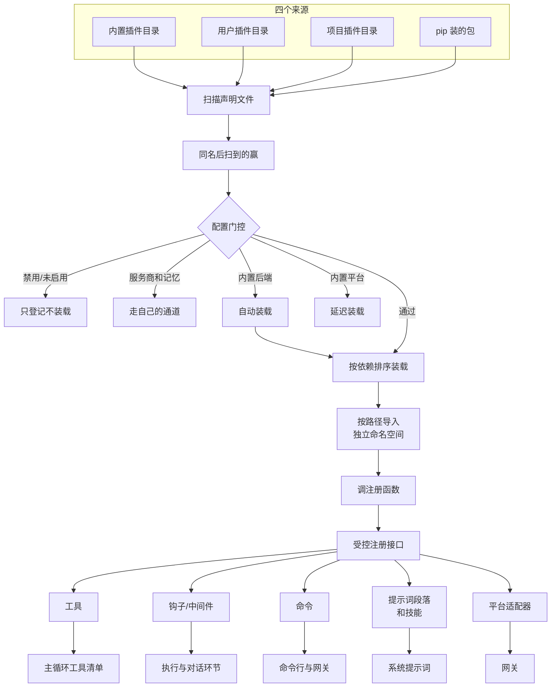

# 插件体系

hermes 的插件 (plugin) 机制：新能力怎么在不改核心代码的前提下挂到 agent 上——插件长什么样、从哪被发现、装载那一刻发生什么、代码在哪些环节被回调、特权怎么授权、第三方插件怎么分发安装、运行中装卸什么时候生效。
本篇以**通用插件**为主线（挂工具、钩子、命令的这种）；模型服务商、记忆后端这类「单选位」插件和平台适配器为什么不吃这套通用流程，收在 Q8。工具进注册表之后怎么组装清单、怎么渐进式披露 (progressive disclosure)，归《工具系统》篇；MCP 服务器的挂载细节归《MCP》篇；本篇只讲「插件这层」。

## 重点地图

按面试出现频率分层。读法：主答是口述稿、必背；追问是被追问时的弹药，通读留印象就行，不用背。

- ⭐⭐⭐ **必考，要能脱口而出**：Q1 全景、Q2 发现与门控、Q4 回调通道、Q5 特权与安全
- ⭐⭐ **高频，要会讲**：Q3 装载过程、Q6 分发与依赖、Q7 运行中装卸
- ⭐ **了解思路即可**：Q8 单选位与平台适配器、Q9 收尾开放题

## Q1：插件体系是干什么的？核心机制主要流程是什么？ ⭐⭐⭐

> **一句话：** 插件是不改核心代码挂新能力的机制——一个插件一个目录：一份清单声明「我是谁、提供什么」，一个注册函数在装载时被调用，通过宿主给的受控注册接口把能力登记进系统各张注册表；启动时从四个位置扫描、过配置门控、按依赖序装载；装上默认不启用，启用写进配置。

**主答：**

hermes 的核心刻意保持小（第 1 篇 Q5 的六级阶梯把「新能力往哪挂」排了序），插件是这条阶梯里「进程内挂能力」的那一级。全部机制围绕三样东西：

1. **插件长什么样**：一个目录，里面一份清单文件 (manifest) 声明名字、版本、提供哪些工具和钩子；一个入口文件实现注册函数，装载时被调用；
2. **注册接口是宿主给的、受控的**：注册函数拿到一个封装好的上下文对象，上面几十个注册方法，小到工具、钩子，大到平台适配器——插件只能通过这个口登记，不能碰核心文件；
3. **发现与装载是一条流水线**：启动时扫描四个来源（内置插件目录、用户主目录下的插件目录（下文简称用户插件目录）、项目目录里的插件目录（项目插件目录）、pip 安装的包；第 1 篇 Q5 从「用户能把插件放哪」的视角说了后三个），同名的后扫到的赢；过一道配置门控（禁用名单、启用名单、特殊类型分流）；幸存的按依赖关系排序、逐个导入、调用注册函数，登记的东西分别落进宿主的注册表，被主循环、网关、提示词组装这些消费方用起来。

内置插件自己也在用这套机制：22 个内置平台插件（网关支持的全部三十来个消息平台里，多数走插件形态）、38 家模型服务商、7 家记忆后端全是插件——核心真的事不关己，只认注册表。



### 追问：插件具体能注册什么？

按「给谁用」分四组记：

- **给模型的**：工具（进那张所有工具共用的注册表，模型当普通工具调）、系统提示词段落（每会话渲染一次的上下文补充）、技能文件（只读、带插件名前缀防撞名）；
- **截流程的**：钩子 (hook，40 多个挂点，工具执行前后、每轮对话前后、会话开始结束，Q4 展开)、中间件 (middleware，能改工具参数、改发给模型的请求，Q4 展开)；
- **给人用的**：命令行子命令（挂到 hermes 命令行上，不用改启动代码）、会话内斜杠命令（CLI 和消息平台里都能用）、界面语言包；
- **接外部系统的**：平台适配器（新的消息平台）、模型服务商、记忆后端、图片视频生成后端、审批通知通道、脱敏规则。

同一个注册函数里想混着注册几样都行——一个插件完全可以又给模型一个工具、又给用户一条命令。

### 追问：能拿一个真实的插件举例吗？

拿内置的 Google 会议插件 (google_meet) 走一遍——它让 agent 能加入 Google Meet 会议：入会、实时抓字幕转录、在会里说话。挑它是因为一个插件把四类注册物占全了：工具、钩子、命令行命令、技能文件。整个插件十来个文件，核心的几个：

```text
plugins/google_meet/
├── plugin.yaml        # 清单：我是谁、提供什么
├── __init__.py        # 入口：注册函数
├── tools.py           # 五个工具的定义与实现
├── meet_bot.py        # 无头浏览器入会、抓字幕
├── process_manager.py # 会议进程的启停与状态
├── cli.py             # hermes meet 子命令
├── SKILL.md           # 技能：教模型开会流程的说明书
└── node/ realtime/    # 远端节点、实时音频两组子模块
```

清单内容（声明身份、五个工具、一个钩子，发现时读的就是它）：

```yaml
name: google_meet
version: 0.2.0
description: "Join a Google Meet call, transcribe live captions, speak in
  realtime, and follow up afterwards. ... Explicit-by-design: only joins
  meet.google.com URLs passed in — no calendar scanning, no auto-dial."
kind: standalone
platforms:
  - linux
  - macos
provides_tools:
  - meet_join
  - meet_leave
  - meet_status
  - meet_transcript
  - meet_say
provides_hooks:
  - on_session_end
```

注册函数（装载时被调用——三类注册一个函数里做全）：

```python
def register(ctx) -> None:
    # Windows: no tested audio-routing path — refuse rather than half-work.
    system = platform.system().lower()
    if system not in {"linux", "darwin"}:
        return
    for name, schema, handler, emoji in _TOOLS:
        ctx.register_tool(name=name, toolset="google_meet", schema=schema, handler=handler,
                          check_fn=check_meet_requirements, emoji=emoji)
    ctx.register_cli_command(
        name="meet", help="Google Meet bot (join, transcribe, follow up)",
        setup_fn=_register_meet_cli, handler_fn=_meet_command,
        description=("Let the hermes agent join a Google Meet call and scrape live "
                     "captions into a transcript. See: hermes meet setup"))
    ctx.register_hook("on_session_end", _on_session_end)
```

跑起来的样子：

- **模型侧**：五个工具（入会 / 挂断 / 查状态 / 取转录 / 说话）各带一份可用性检查——系统对、浏览器库装了才亮，没装依赖的机器上模型根本看不到这些工具，不为它们白花说明书篇幅；
- **会话结束钩子**兜底：会话结束时若还有一个活着的会议（无头浏览器进程），主动挂断——不然每个没关的会话都漏一个孤儿浏览器在后台吃内存；
- **人侧**：`hermes meet` 子命令做设置（装依赖、登录浏览器配置）；
- **注册函数自己决定挂多少**：开头一道平台门，Windows 上干脆什么都不注册——宁可整个缺席，不注册一半吊着。

对照着看就清楚了：插件远不止「给模型工具」——这个例子四组注册物占三组（给模型的工具加技能、截流程的钩子、给人用的命令），注册函数想挂几样挂几样，环境不合适还能一样不挂。

### 追问：有了插件为什么还要 MCP 和技能？什么时候选哪个？

三者是三种不同的挂法，第 1 篇 Q5 的六级阶梯把它们排了序：

- **技能**最轻：一个提示词文件，教模型「这类事怎么做」，不引入代码；
- **插件**是进程内代码：能挂的东西最多（工具、钩子、命令、适配器都能给），但跑在 agent 进程里，装了就得信；
- **MCP** 是进程外协议：外部工具服务器，agent 只当它是个工具来源——给别人的 agent 也能复用，hermes 自己不用维护那部分代码。

怎么选，先看**功能要挂几样东西**。技能只有说明书，MCP 只有工具：功能要把工具、钩子、命令、技能组合起来——工具干活、钩子善后、命令做设置、技能教用法——或者要用钩子、中间件、平台适配器这些只有插件才有的挂法，就只能选插件（上面的 google_meet 就是典型）；只是教模型方法、不引入代码，技能就够。

功能两边都挂得下（比如纯粹只给模型一个工具）时，再看第二层：想让能力跨工具复用、或者不愿把代码放进进程，发 MCP 服务器；只给自己的 agent 用、不图复用，起一个外部服务器不值当，插件更直接。


## Q2：一个插件从文件到被装进进程，流程是什么？（发现与门控） ⭐⭐⭐

> **一句话：** 启动时按固定顺序扫四个来源的插件目录（内置 → 用户 → 项目 → pip 包），每个目录读清单；同名后扫到的赢（用户盖内置是支持的覆盖方式）；然后过一道门——禁用的不要、单选位分流走自己的通道、内置后端自动装、内置平台先登记不导入，剩下的看启用名单，没启用过的只登记不装载。

**主答：**

发现分三步：

1. **扫描**：按内置目录 → 用户目录 → 项目目录（要设环境变量才开）→ pip 包的顺序，读每个插件目录里的清单，目录结构平铺一层或带个分类都认；
2. **同名裁决**：四个来源都扫完后，同名的插件**后扫到的赢**——在用户目录放一个和内置插件同名的目录顶掉内置版本，这是官方明确支持的覆盖方式；
3. **门控**：每个幸存插件按顺序过判定——配置里禁用的只登记不装载；记忆后端、模型服务商这类单选位插件不归这条流水线（Q8）；内置的后端类插件（搜索、生图这类可换后端）自动装载；内置的平台适配器只登记、不导入（追问展开）；其余的看启用名单——插件默认不启用，启用过才装载。

装载动作本身在 Q3。这条流水线在启动时跑：命令行启动会先开一个后台线程提前扫（省一段启动时间），真正需要插件注册表的代码会等它扫完再用。

### 追问：为什么插件默认不启用？内置的为什么例外？

插件是代码，装载就会执行（注册函数一跑，线程、连接、命令全来了）。插件装上不等于启用，中间隔一道用户显式的开关，是把「跑不跑这段代码」的决定权留给用户；安全授权（Q5）也都挂在启用这个节点上。

内置的两类例外各有原因：**后端类**（搜索、生图、浏览器这些）自动装载，因为它们是内置工具的可替换实现，选中哪个靠对应配置项（比如搜索配的哪家引擎），不走启用名单；**平台适配器**是懒装载——见下一个追问。禁用名单对所有插件生效，而且优先——同时写进两个名单也照禁；对这两类绕过启用名单的例外，它是唯一的开关——想关掉自动装载的内置后端，只能写禁用名单。

### 追问：内置平台适配器为什么要「登记但不导入」？

22 个内置平台插件各自依赖自己平台的软件开发包，把这些包在启动时全部导入，会给每次启动白加秒级延迟——不管你用不用 Telegram。所以发现阶段只登记「有这个适配器」，第一个相关请求来了才真正导入。用户自己装的平台插件没这个待遇（直接装载），因为懒装载的收益来自「内置的一堆、用户通常只用一两个」这个事实。

### 追问：系统怎么区分「覆盖内置」和「冒充内置」？

先说官方覆盖长什么样：在用户插件目录建一个和内置插件**同名的目录**，里面放自己的版本——目录名和插件名一致，一看就知道是来覆盖的，放行。冒充是另一种情况：目录名起得普普通通，清单里却声明了内置插件的名字。这种跳过不装——不然用户执行「启用内置的看板插件」，按名字匹配到的可能是一段无关代码，等于借内置插件的名字给自己开了通行证。判定就是拿目录名和被覆盖的内置插件目录名对一下，对得上才算覆盖、对不上算冒充。

### 追问：已经装了的插件被官方召回了，还拦得住吗？

拦得住，而且查四遍：安装时、更新时、启用时、**每次装载时**都比对官方目录的召回（即下架）列表。装的时候拦下容易理解，装载时再查是因为「装了之后才被召回」完全可能发生——官方目录有在线刷新，召回信息立即生效。比对按仓库地址归一化后进行（协议头 http/https、ssh 地址里的 git@ 前缀、结尾的 .git、大小写全抹平，仓库归属和仓库名保留参与比对），召回列表写的是 https 地址、有人用 ssh 地址装的同一家也会被挡。唯一的豁免是安装时显式加参数确认风险，豁免记录存在插件目录之外的安装账本里（本机记录每个插件从哪装、装的哪个版本、豁免过什么的那份档案）——插件仓库伪造不了自己的赦免状。

## Q3：装载一个插件的那一刻发生了什么？ ⭐⭐

**主答：**

三步，每步都有兜底：

1. **导入**：把插件目录按文件路径导入成一个独立命名空间下的模块——不走 Python 的模块搜索路径，不污染环境（追问展开为什么）；
2. **注册**：调用插件的注册函数，把受控注册接口递给它。它登记的每一样东西，宿主都记进一张注册账本（和 Q2 见过、Q6 展开的安装账本是两本不同的账）：登记了什么、怎么撤销（卸载时逆序执行）；
3. **善后**：注册函数抛异常，只禁用这一个插件、记下错误原因，agent 照常启动——一个坏插件不该挡住所有人。整个装载有超时看门狗，超时同样只废这个插件。

装载顺序在装载前就定好：插件可以在清单里声明依赖别的插件，按依赖关系拓扑排序装载（被依赖的先装），同级按名字字母序；声明了依赖但对方没装，只警告不拦——依赖是建议性的，插件该在运行时自己探测对方在不在。


### 追问：为什么按路径导入，不把插件目录加进模块搜索路径？

三个理由：

- **隔离**：加进搜索路径，插件目录里的文件名会和已安装的包互相遮蔽——一个插件自带一个通用的工具模块，可能把环境里正用的同名包顶掉；
- **归因**：所有插件模块都挂在一个统一前缀的命名空间下，系统靠这个前缀认出「这是插件代码」——覆盖内置工具的信任门（Q5）就是这么认人的，插件把自己包在几层回调里也洗不掉出身；
- **可清理**：卸载时把这个命名空间下的模块连子模块一起从模块缓存里驱逐。只删顶层模块不够——子模块的缓存还端着上一次装载的代码和状态，同名的另一个插件装进来会继承到脏东西。

多个配置档案 (profile，第 1 篇 Q4：一套独立的家目录和配置边界) 共用一个进程时（网关多路复用就这么干），同名的两个插件靠档案标识的散列后缀在命名空间里错开，各用各的。

### 追问：注册函数卡死了怎么办？

装载在独立线程里跑，有看门狗盯着，默认 10 秒超时（可配，最高 600 秒）。超时后做两件事：标记这个装载已放弃——之后这个插件再来注册任何东西一律忽略；抛超时错误走正常失败路径（禁用插件、清理已注册的一半）。为什么「之后一律忽略」：Python 杀不掉线程，那个卡住的注册函数可能还在后台跑，它晚到的注册若被放行，会落进刚被清理过的注册表，状态就脏了。

这种卡死的装载线程最多养 8 个，到顶后新的装载直接拒绝——进程已经挂着 8 个卡死的装载，说明该修插件或重启了，不该再往里塞。

限时是怎么实现的（代码有删减，略去线程上下文继承等细节）：

```python
def run_with_load_deadline(plugin_key, ctx, fn):
    # fn = 这个插件的「导入 + 调注册函数」，限时只罩这一段
    timeout = _resolve_plugin_load_timeout()   # 默认 10 秒，配 0 关闭，最高 600
    if timeout <= 0:
        return fn()                            # 关了限时：不开线程，就地跑
    _reserve_abandoned_loader_slot()           # 卡死的装载线程已满 8 个，拒绝再装
    outcome, failure = [], []

    def _worker():
        try:
            outcome.append(fn())
        except BaseException as exc:
            failure.append(exc)                # 线程里不许直接抛，先存下来

    worker = threading.Thread(target=_worker,
                              name=f"plugin-load:{plugin_key}",
                              daemon=True)      # 现开一个一次性线程，不是池
    worker.start()
    worker.join(timeout)                       # 调用线程只等这么久
    if worker.is_alive():                      # 等完还活着 = 卡死了
        ctx._abandon_load()                    # 标记已放弃：它之后再注册一律忽略
        _ABANDONED_LOADERS.append(worker)      # 杀不掉，只能养着（上限 8 个）
        raise PluginLoadTimeout(f"load timed out after {timeout:g}s")
    if failure:
        raise failure[0]                       # 线程里的异常搬回调用线程重抛
    return outcome[0]
```

顺带把线程问题答死：**没有线程池**。这套限时只有一个入口——装载的主路径把「导入＋调注册函数」整个交给这个现开的一次性线程，跑完就丢，插件之间仍是一个接一个串行装；开线程是为了能限时放弃，不是为了并发。不开线程的情况就两种：超时配成 0 就地跑；以及一类不跑 Python 代码的便携插件（只登记技能和 MCP 配置，没有可卡的注册函数），根本不进这套限时。

### 追问：卸载怎么卸干净？

靠装载时记的注册账本：每笔登记都带撤销动作，卸载按登记的逆序执行——后注册的先拆；自己覆盖过别人的（比如替换了内置工具），卸载时把被覆盖的旧值恢复回去。模块缓存按命名空间驱逐；跨档案带身份校验，一个档案的卸载不会误拆另一个档案同名插件的注册。有些注册是进程级基础设施（比如替换整套界面登录方式的模块），常规卸载刻意不拆它——早期版本拆过，结果是整个进程的登录坏到只能重启才恢复。禁用一个插件的实际效果等 Q7 展开。

### 追问：从零写一个插件到生效，要准备什么？

五步，正好把前三问串起来：

1. 建一个目录，写清单：名字、版本、提供哪些工具和钩子；
2. 写注册函数：拿到注册接口后把自己的工具、钩子、命令登记进去——工具给参数说明（模型看得懂的调用说明），钩子声明挂哪个事件；
3. 声明依赖：要用第三方库写在清单里，要的特权能力（Q5）也在这声明；
4. 放进用户插件目录，或者发布成 pip 包；
5. 启用它——启用时会过依赖解析（Q6）和特权授权（Q5），通过后下个会话生效。

验证不用重启碰运气：有专门的体检命令，把插件拷进一个一次性的干净环境里真装真注册一遍，装完还原，报告哪一步出了问题。

## Q4：插件的代码在哪些点被系统回调？ ⭐⭐⭐

> **一句话：** 两大通道——钩子是挂点（40 多个，绝大多数是观察者，回调崩了只记日志；少数能转向：工具执行前可否决/改参数/升级审批、对话前可注入上下文、回复和工具结果可改写）；中间件更深一层，直接改工具参数、改发给模型的请求，或把执行整个包住。

**主答：**

插件的代码被系统回调，走两条通道：钩子和中间件。

**钩子 (hook)**：插件声明关注哪个事件，系统在对应环节把上下文递给回调。挂点有 40 多个，覆盖主循环各环节——工具执行前后、每轮对话前后、每一次发给模型的原始请求前后（一轮对话里模型可能发好几次请求，请求前、成功后、出错三个时机都挂，给观测类插件用的）、会话开始结束、网关收到消息时，还有子代理启停、审批过程这些低频位。绝大多数是观察者：返回值没人看，回调抛异常只记条日志跳过，绝不拖垮主流程。少数能转向，最有分量的三个：

- **工具执行前**的钩子能返回指令：否决（工具不执行，否决理由当成这次调用的结果返回给模型）、改参数、升级人工审批；
- **每轮对话前**的钩子能返回一段文本，注入给模型当上下文（贴在哪见下面的追问）；
- **回复改写**钩子能替换模型这轮的最终回复，**工具结果改写**钩子能替换某次工具的结果文本。

**中间件 (middleware)**：和钩子同一套注册接口，但拿到的权力更大——工具请求中间件能改写工具的参数（在钩子、审批、执行看到参数之前）、模型请求中间件能改写整个发给服务商的请求、执行类中间件干脆把「真正调用工具/发请求」这一跳包住（要放行就调用传进来的那个回调，而且只能调一次）。中间件自己崩了会被跳过，链继续走；不注册任何中间件，原始执行路原样存在。

两类怎么选：只想观察或用那几个固定转向点，用钩子；要系统性改参数、改请求、包执行，用中间件。为什么两套并存，见最后一个追问。

### 追问：哪个钩子失败会反过来拦住工具执行？

只有工具执行前那个钩子是「失败即否决」：回调超时或抛异常，系统当成它投了否决票，工具不执行。方向上是收紧而不是放开——宁可误杀一次工具调用，不放行一个安全钩子没正常把关的调用。其余 40 多个挂点全部相反：回调出问题就跳过它，主流程照走。这个不对称是刻意的：能拦事的那一个钩子必须可靠，其余的都只是旁观者。

同一个钩子多个插件都注册了，否决的优先级高于「升级审批」，跟注册顺序无关——任何一个插件的否决压过其他插件请求的人工确认，不能靠注册得早抢到放行权。这个钩子每次工具执行恰好触发一次，不管调用从哪条路径进来。

### 追问：注入的上下文为什么贴在用户消息后面，不进系统提示词？

因为提示词缓存（第 4 篇 Q3 的核心机制）：服务商按请求前缀缓存，系统提示词加工具清单这段最贵的前缀字节不变才命中缓存；插件每轮注入的内容都不同，进系统提示词等于每轮缓存全失效。所以注入贴在**当轮用户消息**上，系统提示词纹丝不动（记忆插件的检索结果也走这条：记忆有自己的预取通道，取回来的内容和插件注入合并，贴同一条用户消息）。

具体做法是个精巧的两层存储：注入不进用户看到的干净记录（历史里存的用户原话原样不动），但**发给服务商的完整内容**（原话加注入）会单独存一份，之后每一轮请求重放历史用的都是这份——保证重放字节和当初发送的完全一致，前缀缓存在注入这里不断裂。代价也随之而来：注入从此留在每一轮的请求里、跟着占上下文，直到被压缩收掉。

> 带图片的多模态消息是唯一的例外：注入直接并进消息内容里持久保存（消息内容是一段结构化列表，旁车机制挂不上）。

插件想贡献持久性上下文，还有另一条路：注册**系统提示词段落**。两条路一条随压缩走、一条冻结成字节——轮级注入贴用户消息、随压缩收掉；会话级段落进系统提示词，但每个会话只渲染一次、冻结成字节。进程重启后恢复会话，按段落标记从落盘的提示词里把原文切出来，不重跑插件代码；渲染失败保住上一份字节。段落有预算：单段 4000 字符、全部加起来 8000。

### 追问：注入的内容太大怎么办？

单个钩子的注入上限 1 万字符，超出部分写到磁盘文件，贴回去的是头尾预览加文件路径——模型真需要全文，自己拿读文件工具去读。防的是失控插件的巨量注入从此赖在每一轮的请求里：上下文被撑爆、每轮输入费用翻着涨，这笔账比看起来重（见上一问——注入会留在前缀里）。这是个通用思想：插件贡献的内容先落盘、给指针，让消费者按需拉全量。

### 追问：钩子回调里有耗时操作，会拖慢一轮对话吗？

分挂点。主链上的十几个高频挂点（工具执行前后、对话前后、原始请求前后、会话开始结束、回复改写这些）的回调在独立线程里跑、带超时（默认 30 秒，可配），超时放弃那个线程不等它结束——等它就是把卡死的插件请上主路径；重复失败降频记日志，不刷屏。低频挂点（审批观察、任务面板事件这类）没这待遇，同步执行、只兜异常不兜超时——它们本来就在旁路环节上，同步跑省事。所以「回调卡死拖垮主循环」这个担心：主链挂点有超时兜底，低频挂点就算卡死也只卡它所在的旁路环节。

### 追问：中间件权力更大，为什么不全用中间件、要留两套？

分工不同：钩子管看，中间件管改。绝大多数插件需求是观察和统计（记录每次调用、上报用量、注入记忆），这类需求用钩子刚刚好——观察者失败不影响任何人，没插件注册的挂点零开销。中间件是给少数要系统性改写的人准备的：它的回调在**每次**工具调用、每次模型请求的必经之路上，一个中间件出 bug 影响所有调用，出一次错影响的是所有调用，出错面大得多。所以默认路径越薄越好，这么大的权力留给真需要的人——hermes 自带的几十个内置插件里，走钩子的一堆，用中间件的一个没有，这个分布本身就是设计意图的注脚。

## Q5：插件能拿多大的权限？特权怎么授权？ ⭐⭐⭐

> **一句话：** 普通注册启用即用，特权能力单独授权——换内置工具、用宿主凭证跑模型调用、以 bot 身份操作平台等七项，启用时列出风险、一次征得同意，更新只问新增，默认拒绝；同意书是知情授权不是沙箱，防在四个时间点：装前审核加扫描、启用时授权、注册时信任门、运行时同一套审批。

**主答：**

普通注册不需要任何授权——工具、命令、钩子，启用即用。**特权能力**单独授权，一共七项：换掉内置工具（比如替换终端 (terminal)、写文件 (write_file) 这种要害工具）、用宿主的凭证和额度跑模型调用（细分为选服务商、选模型、把调用的记账归到别的 agent 名下等五项）、以 bot 身份在消息平台上做事（加表情反应、改话题标题）。授权流程：启用一个声明了特权能力的插件时，屏幕逐项列出风险说明，用户一次确认整批授予（或整体拒绝）；以后更新只对**新增**的特权重新征求。所有检查默认拒绝，读取授权状态失败也当拒绝。

外围还有几处零散的单独授权：插件要调 MCP 服务器，按服务器逐个授权（默认一个都不许）；要往正在进行的会话里注入一条消息，单独开关。

### 追问：这份同意书是沙箱吗？

不是，官方原话就是「授权加审计，不是沙箱」。插件是进程内的普通 Python 代码，跑起来就有一切权限——授权解决的是**用户知情**（知道这个插件想干什么），不解决**代码不可信**（真不可信的代码根本不该装）。所以防御被安排在四个时间点，各管一段：

1. **装之前**：官方目录人工审核（每条钉死 commit，升级要重新过审）；安装时静态扫描（下一个追问）；
2. **启用时**：特权授权（本问主答）；
3. **注册时**：覆盖内置工具的信任门——没授权直接报错，插件禁用；
4. **运行时**：插件工具的调用走和内置工具完全相同的审批管线，不宽不严；插件唯一能做的是把某次调用**升级**成人工审批，不能放松。

非交互场景（脚本、无人值守安装）遇到要授权的事一律拒绝而不是替用户点头——宁可拒绝也不放行，这是这套体系一贯的 fail closed（拿不准就拒）。

### 追问：安装时的静态扫描做什么？

代码运行之前扫一遍待装的目录：拿一套威胁模式正则匹配全部文件（偷凭证的套路、提权命令、混淆编码），加结构检查——符号链接不许指向目录外（防扫描时看到的是干净代码、运行时读到的是别的东西）、捆绑的二进制文件算高危、文件数量和体积有上限。结果三档：干净直接装；可疑要用户确认；确认危险直接拒绝，连强制参数都压不住——第三档没有绕过通道。

扫描器还为插件仓库专门减少误报：那套正则本来是给「模型会逐字当指令执行的技能文件」设计的，代码仓库里 README、测试样例出现同样文本很正常，所以按文件位置和语境降级（只降级、不静默删除，报告里都留着）。

### 追问：插件能偷偷换掉写文件的工具吗？

不能悄悄做，明着做要过三道：注册时声明覆盖并拿到授权，否则直接抛权限错误（这一下插件就被禁用了）；覆盖动作记审计日志；撤掉别人的注册同样受这道门管（不然先注册再撤别人的，绕一圈照样偷梁换柱）。还有一层出身校验：判断「这次注册来自哪个插件」看的是处理函数定义在哪个模块——插件把函数包几层闭包传进来，出身还是插件命名空间，洗不白。

内置插件豁免这道门——那是维护者随版本发布的决定，不是第三方提权。

## Q6：从官方目录装一个第三方插件，流程是什么？（分发与依赖） ⭐⭐

**主答：**

官方目录是一个随主仓库维护的清单库，每个插件一条记录，**钉死到一个 commit 哈希**、人工审核合入——「进目录」本身就是审核，升级版本要重新过审。装的时候：按目录记录里的地址浅克隆那个 commit 到用户目录，过静态扫描，**装完默认不启用**。启用则走一步整体校验：插件声明的 Python 依赖和核心、其他已启用插件的依赖**一起**在一套新环境里解析构建，构建成功才把启用写进配置——解析冲突、构建失败、配置写入失败，任何一个环节出问题，配置和依赖环境都保持原样，不存在「启用了但依赖没装上」的中间态。

更新同理：官方目录装的插件重新克隆到新 commit（从不在原目录上拉取），依赖环境跟着一起换。

### 追问：为什么强制钉死 commit？

审核审的是具体的代码快照，不审一个会动的分支。钉死后目录里每条记录对应唯一一份验证过的代码，克隆下来的和审过的保证是同一份；想升级就得提新的审核。运行时再叠一层：目录有在线刷新的召回信息（缓存 6 小时、断网时召回记录永不过期），装完后被召回也拦得住（Q2 追问讲过装载时复查）。安装来源、commit、是否豁免过召回，全记在插件目录**之外**的安装账本里——仓库内容归仓库控制，账本归本机，插件伪造不了自己的凭证。

### 追问：插件的依赖为什么要统一管？不让插件自己装？

一个进程一份 Python 环境。各装各的早晚撞车：两个插件要同一个包的不同版本，后装的把先装的顶掉，先装的静默坏掉。所以 hermes 把「核心 + 所有启用插件的依赖」当一个整体，用统一的包管理器在启用时解析：并集能共存才放行，冲突就拒绝启用并告诉用户是谁和谁撞了。代价是启用一个插件可能因为依赖冲突失败——但失败得干净（环境原地不动），好过装上后静默坏掉。

自管运行时的插件（自带一整套解释器和依赖、自己在旁边跑的，比如要起独立小服务的那种）可以声明「依赖我自己管」，不进这个联合体——代价是享受不到统一的冲突检查。

### 追问：更新依赖为什么不直接改现有环境，要新建一套？

每次依赖变更不在原环境上改，而是构建一套**全新的环境目录**，全部构建、验证通过后，把「当前用哪套」的指针原子地切过去。旧环境不删——正在跑的进程在启动时租住了它那套，跑完为止；回收器只清没人租的旧套。这换来两个性质：任何一步失败，旧环境原封不动，跑着的进程无感；更新一个插件等于构建新环境加切指针，进程里已加载的旧代码继续用旧环境跑完这一程，下次启动用新套。构建新环境很贵，所以按内容判断要不要重建：核心和各插件依赖算出的哈希没变，就直接复用现有环境。

### 追问：更新防什么？

防的是更新的改动范围超出当初审核过的范围：更新前先把新版本克隆到一个预览目录，对比新旧清单能提供什么（特权声明、工具、钩子、依赖、界面声明五类），**新增**的特权要重新征得同意才继续——旧版本老老实实，新版本加了个「换内置工具」，用户得再点一次。用户改过插件代码的，按装法分两种处理：官方目录装的（钉着 commit）重新克隆，本地改动不搬过去、原样备份到专门的备份目录——改动和更新二选一，不搞合并；自己拿仓库地址装的走快进拉取，改动先暂存、拉完尽量还原，冲突时改动留在暂存里不丢。自动更新默认只检查不实际安装——后台定时查一遍有没有新版，记一行日志完事，不动环境、不改提示词；要真自动装得显式打开开关，而且只对「自己拿仓库地址装的」那种生效（官方目录装的钉着 commit，从定义上就不存在「自动追新版」，想更新走重新审核）。

### 追问：hermes 给自己的依赖设了新包两周隔离期，插件依赖为什么不管？

隔离期只管得住 hermes 自己依赖清单里的包：那份清单它自己维护，新发布的包压两周再纳入，抢注同名新包投毒这种事来得及被发现。插件的依赖是插件作者声明的，hermes 替它设隔离期没意义——真被投毒，作者自己把版本上限写成昨天刚发布的那个版本就绕过去了。所以责任划给作者：官方指南要求作者给自己的依赖设版本上限（目录审核会盯裸下界——只写下限、来者不拒的声明会被标记），隔离期则是强烈建议、不强制。

## Q7：网关正在跑的时候装/停插件，什么时候生效？ ⭐⭐

**主答：**

判定标准一条：**改不改模型看得见的提示词前缀**。

- **立即生效**：会话内斜杠命令（网关每条消息都现查命令表，写入即活）、平台事件回调（装完通知网关强制重扫，已连接的平台适配器把新插件的回调挂到平台连接上）、语言包；
- **等下个会话**：插件自己的工具、系统提示词段落——正在进行的会话里，模型看到的工具数组和提示词字节保持不变，新工具、新段落等新会话才进来（和技能安装同一条规则）；
- **第三条路**：插件带来的 MCP 服务器——当下就连接、对打开的会话立即可用，效果上模型最迟下一轮就能用上它的工具。为什么它不算破例，见追问。

**停用是不对称的**：只写配置，已经在平台那边挂好的回调不摘——摘除需要每家平台各自的反注册接口，这东西不存在。兜底是下一次强制重扫或重启：重扫开头会先把所有插件全量卸载再装回来，没回来的（禁用的、删掉的）自然就没了。所以「禁用生效时间」= 下次重扫或重启，期间它的回调还活着，装插件的输出里也会如实告诉你。

### 追问：怎么通知正在跑的网关？

控制通道。安装/启用/更新的命令改完磁盘和配置后，向网关的控制端口发一条「重载插件」消息；网关在后台线程强制重扫，再让每个已连接平台的适配器把新插件的回调挂到平台连接上。挂接用「插件 + 函数限定名」做幂等键——重扫会产出新的函数对象，按对象身份判重会把同一个回调挂两遍。本进程自己也重扫一遍（命令可能跑在带界面的进程里）。控制通道没人应答（网关没在跑），就提示需要重启。

### 追问：为什么插件工具要等下个会话，MCP 工具却下一轮就能进？

MCP 工具能中途进清单，靠的是一套专门做的刷新路径：服务器故障恢复、懒连接、重新加载是常态，等不了会话结束，所以专门实现了「轮次间刷新＋尾部追加」——会话构建时定下的那份工具数组（快照）在这里重算，新工具排在尾部、已有工具纹丝不动，尾部追加不改前缀，缓存照样命中（《MCP》篇 Q6 详述）。装载插件时只把 MCP 服务器登记进注册表、不去刷新正在跑的会话的快照，模型当轮看到的字节不变；这些工具随后随 MCP 的刷新进清单。

插件装载是低频操作，为它把这条刷新路径铺到每个入口，换来的只是「少等一个会话」，不值——统一承诺「下个会话生效」最简单、最不容易错。这也是整个插件体系反复出现的一条原则：插件的一切表面变化，允许慢半拍（下个会话、下次启动），但不让会话内的字节轻易变形。

## Q8：记忆、模型服务商、平台适配器，为什么不吃这套通用流程？ ⭐

**主答：**

先分两路：记忆后端、模型服务商、上下文引擎、图片视频生成是**单选位**——配置里一个键指定同时只让一个生效，多选的启用名单管不了「只能选一个」，激活都走各自的配置键；平台适配器不是单选（多个平台可以同时在线），它只是装载方式上有个变体。按离通用流水线的远近，这几种分三档：

- **只是消费端单选、装载照旧**：图片视频生成这类后端走的就是 Q2 的通用流程（内置的自动装载、用户装的看启用名单），单选发生在用的时候——配置键指定哪家生效；
- **连发现通道都另起一套**：模型服务商、记忆后端、上下文引擎（上下文引擎目前内置的一个都没有，位子留空给插件）。模型服务商**懒发现**——第一次有人要服务商清单（认证、配置、模型列表）才触发导入，38 家全在启动时导入太重；用户盖内置靠**后注册的赢**：用户插件目录里的服务商注册得比内置晚，后注册的顶掉内置那条——装一个同名服务商插件就完成替换。记忆后端方向相反，**内置优先**——往用户插件目录丢一个同名的记忆后端目录，不该悄悄顶掉随产品发布的后端（记忆是跨会话的持久资产，后端换了行为全变，追问展开为什么方向和服务商相反）；
- **通用流程的变体**：平台适配器走启用名单（用户装的）或延迟装载（内置的，Q2），但注册的是平台适配器，由网关消费。

### 追问：为什么记忆后端和模型服务商的覆盖方向不一样？

看「换掉默认的那个后果有多重」。换模型服务商是轻决策：这轮调不通换一家，配置改回来就还原，用户目录盖内置等于「我想用自己的账号」，合理默认。换记忆后端是重决策：所有跨会话记忆长在那个后端里，静默换掉等于记忆「消失」——所以默认偏向内置，切换必须显式写配置键。方向差异不是随便定的，是按出错代价排的。

### 追问：有不写 Python 代码的插件吗？

有，走一套兼容格式：目录里放一个 JSON 清单、若干技能文件、一个 MCP 服务器配置文件，就算一个插件。装载**不导入任何 Python**——只把技能登记成只读命名空间（带插件前缀，不进系统提示词里的技能索引，模型用列技能的工具现查全名、按全名取用），把 MCP 配置合并进现有通道（和用户自己配的服务器重名时用户配置赢，插件之间先装的赢）。这是给「一个包发到多家 agent 工具上复用」的跨工具标准留的兼容层——能提供的东西只有技能和 MCP 服务器两样，深度集成（钩子、中间件、命令）只有原生插件才有。

## Q9：这套插件体系最大的代价是什么？让你改你会改哪？ ⭐

最大的代价是**进程内信任模型的兜底太薄**：Q5 那四道门，前三道在代码跑起来之前，第四道（运行时审批）也只管单次工具调用——代码一旦跑起来，插件和宿主同生共死。装载有超时看门狗、主链上的钩子回调有 30 秒超时，但工具执行里的死循环、内存泄漏没有任何按插件记账的手段，一个失控插件吃掉的 CPU 和内存全算在 agent 头上，用户只能靠「禁用插件」这种全局开关自救。

让我改，我会给**运行时加资源记账**：工具调用本来就要经过执行包装那一跳（Q4 的执行类中间件就挂在这），在这层链尾加一层记账，按插件统计 CPU 时间和内存增量（出身归因的机制现成——Q3 说过模块都在插件命名空间下），超限先把该插件的工具降级成「返回错误提示」，连续超限建议禁用。数据从哪来：执行包装的采样，账本里每笔注册都记着归属；什么时候动：先只记账不干预，跑一版看清真实分布再设阈值；动一次的代价是所有工具调用多一层包装的开销，以及「误杀重计算型插件」的策略成本——所以阈值要能按插件配置。

比起「改成进程外插件」这种推倒重来，记账是当前架构里动得最小、收益最直接的一刀——真要进程外隔离，钩子和中间件这些深度集成本身就不成立了，那等于放弃这套体系换来的能力。
