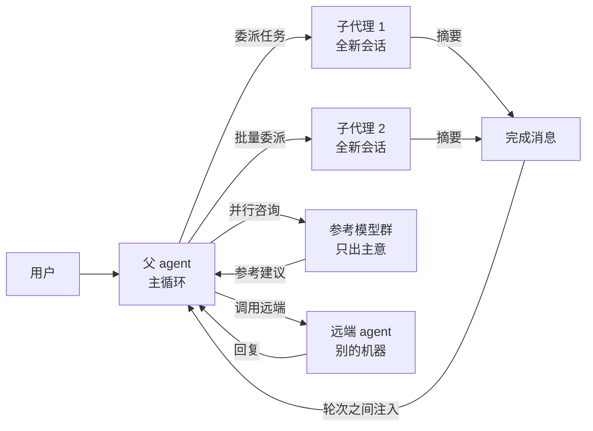

# 子代理与多智能体

hermes 的「多个 agent 协作」：委派工具 (delegate_task) 的进程内子代理是主线，MoA（Mixture-of-Agents，模型混合）和 A2A 是同一主题的另外两种形态，各自成问（Q6、Q7）。
主循环侧为什么委派不走工具注册表，见《Agent 主循环与编排》篇 Q6；工具说明动态改写（把并发上限写进说明书）见《工具系统》篇。

## 重点地图

按面试出现频率分层。读法：主答必背（那是口述稿），追问通读留印象（那是被追问时的弹药，不是背诵清单）；时间紧就先看三星：

- ⭐⭐⭐ **必考，要能脱口而出**：Q1 全局、Q2 子代理怎么跑、Q3 结果怎么回流、Q4 嵌套与编排（含业界对比）、Q5 控制与兜底
- ⭐⭐ **高频，要会讲**：Q6 MoA、Q7 A2A、Q8 代价与改进

## Q1：子代理与多智能体是干什么的？hermes 里多个 agent 协作有哪几种形态？ ⭐⭐⭐

> **一句话：** 跟「多个 agent 协作」沾边的是三样东西——进程内的子代理（委派工具，主线）、轮次级的模型混合（MoA，只出主意不干活）、跨机器的对等协议（A2A，别人家的 agent 当工具调）。面试问「子代理」问的是第一个。

**主答：**

hermes 里「多个 agent 协作」落在三个层次，解决的问题各不相同：

1. **子代理（委派工具 delegate_task）**：主 agent 把一个自包含的任务（「去查这三个文件的依赖关系」）连同一份背景说明交给一个新开的 agent 实例，它在独立的上下文里自己跑工具循环，干完只把摘要交回来。解决两个问题：并行（一批独立任务同时跑）和上下文隔离（脏活的重度工具输出不进主对话）。
2. **MoA（Mixture-of-Agents，模型混合，/moa 命令）**：一个用户轮次里，先并行问几个「参考模型」对当前任务的建议，把各家建议编成参考块交给真正干活的主模型，它带着参考继续做事。它不是多智能体——参考模型没有任何工具、不执行任何东西，只是出主意（Q6 详述）。
3. **A2A（agent 对等协议，插件）**：跨进程、跨机器跟别家框架的 agent 互发任务——出站方向把远端 agent 当工具调，入站方向自己变成一个可被调用的「平台」。对方是对等体，不受你控制（Q7 详述）。

主线是子代理。一次委派的旅程：模型调用委派工具，系统在**同进程**里构造出一个子代理——全新对话、按任务定制的系统提示词、继承自父代理但裁剪过的工具集 (toolset)——放到后台线程跑；父代理拿到一份派发回执后这一轮就结束，不用干等；子代理干完后摘要作为一条新消息在轮次之间流回主对话。父代理（正常运行时）只看到委派调用和最终摘要，中间的工具调用、推理一个字不进父的上下文。

### 追问：MoA 和子代理是不是一回事？面试怎么区分？

不是。一句话点破：**子代理会执行，MoA 的参考模型只出主意**。子代理是一个完整的 agent 实例——有自己的工具、自己的主循环、真的会跑命令改文件，产出是干出来的结果摘要；MoA 的参考模型收到的是当前对话的一个文字快照，系统提示词里钉死「你不是执行者，绝不能声称执行过任何操作」，产出只是建议文本，干活的主模型可以采纳也可以无视。控制关系也不同：子代理在进程内，父能实时纠偏、叫停（嵌套时整棵派生树一起停，见 Q5）；参考模型一次调用的事，发出去就只能等结果。A2A 则反过来——对方不在你进程里，连「控制」都谈不上，只能按协议交换任务和结果。

## Q2：模型调用委派工具之后，一个子代理是怎么跑起来的？ ⭐⭐⭐

> **一句话：** 现场构造一个全新的 agent 实例——独立对话、按任务定制的提示词、裁剪过的工具集——放到后台线程跑它自己的主循环，干完只交摘要。

**主答：**

三步。第一步**构造**：系统在主线程上逐个新建 agent 实例（构造不是线程安全的，批量也是先在主线程建好），给它一份按任务定制的系统提示词、一个全新的空对话、一个独立的终端会话，工具集继承父代理但砍掉一批禁用项。第二步**跑**：子代理放进后台线程池，跑的就是同一个主循环——它也是一次一次调模型、执行工具、迭代到任务完成或预算用尽（迭代预算独立于父计算，默认值在《Agent 主循环与编排》篇讲过）。第三步**交摘要**：循环结束时子代理的最后一条回复就是交付物，包装成一条结果记录（状态、摘要、耗时、token、成本、工具轨迹）回给父代理。批量委派（一次传一组任务）就是同时构造一批，并发跑，各自出一条记录。

### 追问：什么样的任务值得委派？什么时候不该用？

三个正向判据：任务**推理重**、中间过程对父没有价值（父只要结论）——过程里的重度工具输出正好隔离掉；任务**自包含**——子代理问不了用户，缺什么背景都得随任务给全；多个任务**相互独立**——一批并行跑收益最大。四个反向判据（工具说明书里明写给模型）：机械的多步操作没有推理量，用执行代码工具 (execute_code) 更省；一次工具调用就能干的事直接调，不值得开一个 agent；要跟用户来回交互的事派不出去（子代理不能提问）；要活过本次会话的持久工作不该委派（后台委派跟会话同生共死，Q3 讲）。一句话归纳：**父不需要中间过程、任务自己说得清**，才值得开一个独立上下文去跑。

### 追问：子代理和父代理的边界到底划在哪？

同进程、不同世界。子代理跟父跑在同一个操作系统进程里（省了进程间通信），但**上下文完全隔离**：独立的对话历史（从空白开始）、独立的终端会话（自己的工作目录记录，虽然起点继承父的）、独立的迭代预算。四条「不许」划出行为边界：不许向用户提问（没有澄清回调，问题问不出去，所以任务必须自包含）；不许读写共享记忆（主 agent 的跨会话记忆它碰不到）；不许跨平台发消息；不许以父的名义安排定时任务——后两条都是「冒充主人产生副作用」的口子，外加看板工具整组禁掉（不能替主人动任务管理）。兄弟子代理之间也没有对话通道，谁看不见谁的上下文——要协作只能经父中转，或靠共享的文件系统间接传递。反过来，子代理的会话记录写进同一个会话库并标注父会话 id，事后检索、审计查得到它是谁派的。它的执行代码工具是保留的——真要干活就得能跑代码。

### 追问：子代理的系统提示词是怎么来的？

模板拼装，五段：一句身份（「你是专注单个委派任务的子代理」）、任务背景（调用方给的 context 原文）、工作区路径（从父的真实工作目录解析来的绝对路径，宁缺毋滥，绝不编造不存在的路径）、项目上下文文件（子代理默认跳过上下文文件加载，这里手动把工作区的 AGENTS.md 这类约定文件注进去——否则子代理在仓库里干活不知道仓库的规矩；记录人格设定的身份文件跳过，人格属于父）、完成指令（要求摘要先讲结果、用要点、别复述全过程，并明说「你的回复会作为摘要返回给父代理，太长会挤占父的上下文」）。有个设计细节：任务目标本身不进系统提示词，而是作为子代理的**第一条用户消息**——保持「用户提需求、模型响应」的正常轮次结构。

### 追问：子代理的工具集怎么定？

模型侧没有点名工具组的参数——工具集要么整份继承父的启用集，要么被系统再砍掉禁用项。禁用清单是硬的：委派本身（防不受控递归）、澄清提问、记忆、跨平台发消息、定时任务管理，五个工具永远拿不到。「显式收窄」存在于插件走的公共子代理接口（Q2 最后一个追问）：插件发起时可以限定子代理只用哪几个工具组，同样只窄不放——要的组必须是父真有的，子代理永远拿不到父没有的工具；收窄时父的 MCP 工具组默认跟着继承（可关）。嵌套编排下编排者（会再派子代理的中间层，Q4 详述）的委派工具是**角色给的**、不走继承——模型没法靠自己在任务里写工具组名偷到委派能力。

### 追问：子代理可以跑跟父不同的模型吗？

可以——模型可以钉到别的路由，凭证跟父共用一个池。默认继承父的 provider 和模型；配置里可以把子代理钉到另一条路由（比如重活派给便宜模型）。凭证池共享解决的是并发撞限流：一批子代理同时打同一个服务商，撞上限流时能换一把 key 接着跑，租约机制保证并发兄弟之间不抢同一把。

### 追问：为什么子代理不用 1 小时档的提示词缓存？

先补个背景：提示词缓存按留存时长分档计费（《上下文工程》篇），对话每追加一段新内容（工具结果、模型回复），变长的部分都要按所在档位的写入价写一次缓存。厂商的 1 小时档写入价是 5 分钟档的 1.6 倍左右，赌的是「人离开几分钟再回来、命中长留存」；子代理几秒一次调用、几分钟就退出，永远收不到长留存的收益，却每段新内容都付 1.6 倍的写入价——纯亏。所以子代理被强制降到 5 分钟档；缓存本身开不开照旧，只是不选贵的档位。

### 追问：插件代码想直接启动子代理，不走模型行不行？

行。hermes 给插件开了一套公共的子代理生命周期接口：轮次活跃时插件可以发起「启动 / 等待 / 取消 / 取结果」，拿到一个可序列化的句柄，状态从排队、启动、运行到终态一路可查。三个要点：启动必须发生在活跃的 agent 轮次里，轮次外调用直接报错——防插件在无人监督时凭空造 agent；结果不可变、有 32k 字符上限、不含中间过程；进程内只保留一小时，进程重启后句柄作废、绝不自动补启替代品。底层走的是跟委派工具同一条通道——子代理的花费照样记回父会话的账（回卷）、启停钩子照样触发，不是绕开监管的旁路。

## Q3：父代理怎么拿到子代理的结果？同步等还是异步？ ⭐⭐⭐

> **一句话：** 顶层委派永远后台——工具立刻返回派发回执，模型结束轮次，结果在轮次之间作为新消息流回；嵌套委派（子代理派孙代理）反过来，同步在工具调用里等完。

**主答：**

顶层的委派（直接服务用户的那个 agent 发起）一律走后台：工具调用当场返回一份派发回执，然后**这一轮就结束了**，父代理该干嘛干嘛；子代理在后台跑完，摘要包装成一条完成消息，在父对话的轮次之间注入，父开新轮次消化它。嵌套委派反过来：编排者（Q4 详述）的产出依赖它派出的子代理（worker）的结果，它的「轮次」就在那次工具调用里，所以同步等完、结果直接在调用内返回。为什么顶层强制后台、不让模型选：主循环是纯同步的，一个工具调用挂几分钟等于把整个轮次、整条会话锁死；后台化以后模型可以继续处理不依赖结果的事，工具说明书里明写「给一行状态，结束轮次，别去轮询子代理的转写文件（它操作过程的实时日志）」。

### 追问：什么情况下顶层委派会退回同步执行？

两种场合，回退时结果直接在本次工具调用里给出、附一句说明。一是**跑完即散的会话**：cron 定时任务、一次性命令行、无状态 HTTP 这些场景没有「下一个轮次」可接收回流，异步派发等于把结果发给一个不存在的收件人，所以当场同步跑完。二是**后台池满**：并发后台委派有上限，池满时新任务不排队而是直接拒绝——防失控的模型无限堆积后台工作——调用方退回同步执行；这时宁可占住轮次当场跑完，也不把任务直接失败掉，说明里还告诉用户去哪调大上限。

### 追问：结果条目里都有什么？怎么判断一个子代理「算完成了」？

一条结果记录两组核心字段。**状态**是给父的粗分类（完成 / 被打断 / 失败 / 超时 / 出错）；**结束原因**是循环侧的细分（干完 / 迭代预算用尽 / 被打断 / 出错 / 超时）——「干完」和「迭代预算用尽没干完」是两个值，父就靠这两个字段分辨干没干完。**截断标志**在结束原因是预算用尽时为真——预算用尽的子代理照样有摘要，父需要这个显式标志分辨「做完的摘要」和「没做完的遗留文本」。其余字段：摘要（子代理最后一条回复原文）、token 数、成本（美元）、工具轨迹（每一步调了什么工具、参数多大、结果多大、成败）。被打断的子代理摘要有个讲究：取它**最后一条真实的回复文本**，而不是循环收尾时那句「操作被打断」的占位符——父拿到的是「它做到哪了」。

### 追问：子代理的摘要可信吗？父代理怎么验证它真干完了？

不盲信——工具说明书里明写给模型：摘要只是子代理的一面之词，不是核实过的事实，「上传成功」「文件已写」可能是假的。验证靠三层：先看**截断标志**和**结束原因**，分辨「干完了」和「预算用尽没干完」；再看**工具轨迹**——摘要之下的第二层证据，哪一步失败了、结果多大，跟摘要的说法对不对得上；最后对**外部副作用**（上传、发布、远端写入）要求子代理交能拿去核验的凭单（链接、编号、绝对路径），父自己拿凭单去验，验过了才告诉用户成功。这条规矩写在工具说明书里而不是代码里强制——它是给模型的纪律，系统兜不了底。

### 追问：子代理的摘要很长，会不会撑爆父代理的上下文？

有预算机制兜着，两层。静态层：单条摘要默认 2 万 4 千字符封顶。动态层：按父的**剩余**上下文余量算——取余量的一半摊给这一批的所有摘要，不够下限就给保底。超了不硬删：留头四分之三、尾四分之一——做了什么、结论、改了哪些文件、还有什么问题，这些头尾信息都保留——中间挖掉的全文落盘成一个文件，摘要尾部附一行「完整输出在哪、从哪个偏移读起」的指引，父代理需要时用读文件工具翻页。设计动机是防「压缩和限流的死亡螺旋」：一批子代理的摘要一起涌入，把父顶过上下文上限触发压缩，压缩又作废缓存——索性在入口就限流。

### 追问：进程重启了，后台子代理的结果丢吗？

完成的不丢，跑一半的救不回来。**完成的不丢**：每次后台委派的派发和完成都持久化到本地 SQLite，完成消息没送达就保留重试——最多投递 8 次、记录保留 7 天，网关（多平台共用的常驻进程，《总体架构》篇）重启后能把没送完的接着送。**跑一半的救不回来**：子代理是进程内的线程，进程退出就断，绝不自动补一个替代品接着跑（补跑等于把一个做到一半的任务重放一遍，副作用不可控）。所以工具说明书里写明：要「活过重启」的工作用定时任务或后台终端命令（它们有进程外的执行实体），别指望后台委派扛重启。

### 追问：一批任务里最快的先挂了，要等最慢的吗？

不用等，两个机制让坏消息先行。其一，**失败即时通知**：后台批里某个子代理失败了，立刻推一条失败通知给父，不等整批结束——这个设计来自一次真实事故：上千个子代理的第一波全撞在鉴权失败上，父要等 66 分钟后整批结果回来才知道全灭了，中间什么都没跑。其二，可选的**分单元回报**（默认关）：默认整批合成一条消息回来；开启后按任务编组拆单元——同组的合起来报，没编组的各自完成各自报，快的先走。同一次调用拆出的所有单元在并发名额上算一份，拆单元不多占名额。

## Q4：子代理能不能再派子代理？orchestrator-worker 是怎么做的？ ⭐⭐⭐

> **一句话：** 能，但默认关——默认只有一层（父派叶子）；开嵌套后按深度自动给中间层「编排者」角色，编排者可以再派「叶子」，叶子到底。

**主答：**

能不能再派不是模型自己声明的（调用参数里的角色字段是历史遗留、已被忽略），而是**系统按深度推导**：每个子代理出生时带着自己的深度，配置的上限之内且编排开关打开，它就是编排者（orchestrator，保留委派工具，其他禁用项照旧）；到顶了就是叶子（leaf，没有委派工具）。默认上限是 1——扁平结构，父派的全部是叶子；调到 2 才有「编排者→叶子」的两层。深度事实会写进编排者的系统提示词（「你在第几层、树最多几层、你的孩子还能不能再生」），让它规划时对可用的结构心里有数，不至于臆造出不存在的嵌套。编排者的等待方式上一问说过：深度大于零的委派强制同步，worker 的结果在编排者自己的工具调用内返回，它汇总各方产出、自己写最终摘要——「对父负责的是编排者，不是 worker」。

### 追问：为什么默认扁平、嵌套要显式开？

成本。每多一层，一次任务的最坏调用量乘上扇出 (fan-out) 宽度——两层结构里 3 个编排者各派 3 个 worker，就是 9 份 worker 会话外加 3 份编排者自己的，每份都自带系统提示词和工具清单的固定开销。多数任务一层扇出就够（并行查、汇总），真正需要「分解-递归」的是少数。所以默认给安全的扁平，愿意付成本的用户显式调上限。配套的护栏：并发子代理数有上限（默认 10，写进工具说明书让模型看得见）、调高时留一条警告记录「成本线性放大」、编排有个总开关可以一刀切回扁平。

### 追问：业界其他主流的做法是怎样的？

产品系先看三家。**Claude Code** 的子代理是文件定义的：一个带元信息头的 Markdown 文件就是一个子代理（名字、描述、工具白名单、模型、权限模式），描述写得「主动型」时模型自动委派，也能显式点名调用；每个子代理独立上下文窗口、只回传摘要，支持并行（默认并发上限 20）和后台运行；默认允许嵌套三层；运行中可以在面板里发消息纠偏。**OpenAI** 是两条路线：SDK（Agents SDK）的多智能体靠**交接 (handoff)**——把「转接」做成一个工具，模型一调控制权就转移过去、对话历史跟着走，本质是**链式转移不是并行扇出**；API 侧（Responses 的多智能体，测试版）才是原生并行——根模型可以开出子代理树，宿主侧提供生成、发消息、等待、中断这几个基础操作，默认并发上限 3。**ChatGPT** 产品侧的 Agent Builder 用可视化画布编排多智能体工作流，属于面向用户的低代码形态。框架系（LangGraph、AutoGen、CrewAI 这类）又是另一种形态：编排是显式的——谁跟谁连接、状态怎么流转，先在代码或配置里画好再跑；hermes 和上面几家产品走的是「编排进对话」——要不要委派、派几个，由模型拿着委派工具临场决定。回接一句：各家殊途同归在「独立上下文 + 摘要回流 + 有上限的并发」，hermes 的辨识度在控制平面（运行中逐个纠偏/叫停，Q5）和成本治理（默认扁平、费用回卷记账，Q3、Q4）。

## Q5：子代理跑飞了怎么办？运行中能控制吗？ ⭐⭐⭐

> **一句话：** 能控制，三道闸——模型侧的实时控制动作（列清单、纠偏、叫停）、心跳监护判僵死、用户侧的暂停开关；外加打断会顺着派生树传下去。

**主答：**

模型用的是同一个委派工具的控制模式：**列清单**（当前会话派出的活子代理：编号、目标、模型、运行时长、状态、转写路径）、**纠偏**（往某个子代理排一段「方向修正」文本，它不停）、**叫停**（请求某个子代理在下一个迭代边界收工，已干的部分照样回来）。归属校验收两种证明：调用方要么沿着派发链证明「我是它祖先」，要么用持久会话 id 对上派发关系——只能控制自己这棵树，管不到别的会话的子代理。监护层是心跳：等待期间定期看一眼子代理有没有进展，同时刷新父的活动时钟，防网关的空闲超时把正在等子代理的会话误判成挂了；连续多次心跳都没进展就判僵死、放弃等待（怎么判见下问）。用户侧还有个一键暂停：挡住所有**新**委派，已经在跑的不管。

### 追问：怎么判定一个子代理「卡死了」？等模型回复很久算卡死吗？

不算，这是判定里最要紧的区分。进展看三个信号：完成的模型调用数变了、当前工具变了、活动时钟（最近一次活动的时间戳）走了。**等模型回复时活动时钟一直在走**（底层网络请求有周期性心跳会刷新它），所以一个慢服务端慢慢吐答案的子代理是「活着的慢」，不是死；真正判死的是三个信号**同时冻结**——对话空转 450 秒，或者钉死在同一个工具上 1200 秒（工具里给更宽的线，因为合法的长工具存在：大构建、大下载）。判死后不是硬杀：发中断信号、放弃等待、结果里写明「第 N 次调用后再无动静」；要是子代理连第一次模型调用都没发出去就僵了（提示词构造或凭证解析卡住），额外落一份诊断文件——配置、提示词和工具清单的大小、当时所有线程的调用栈——不然「超时、零调用」是个黑洞，无从查起。

### 追问：纠偏怎么做到不打断子代理正在跑的工具调用？

纠偏文本排队之后，在下一个迭代边界作为一条**独立的用户消息**插在最近一批工具结果之后——正在跑的那个调用、已经落库的工具结果原文，从头到尾都不动（改写已落库的内容会破坏只追加的会话存储和提示词缓存，正好撞全局禁令）；模型下一轮看到这条插入的用户指示，自然转向。代价是可能错过：子代理干完收尾了、再没有下一个工具边界可插入，这段纠偏就送不到——结果记录里会明确标出「这段纠偏没送达」，而不是悄悄吞掉。叫停也是协作式的：设中断标记、在迭代边界生效、请求在途工具取消，不硬杀线程。

### 追问：为什么不默认给子代理设一个总时长上限？

因为总时长上限杀的往往是健康的孩子。真实教训：上线过按总时长封顶的看门狗，复盘全部 75 起误杀，没有一起死在工具里——全部发生在「等待一个很慢但活着的模型回复」时；慢服务端本来就是这个行当的常态，墙钟一到期，跑得久的就是先死。所以默认**不设**总时长，卡死交给上面说的僵死判定（它分得清「慢」和「死」）；真要限，配置给的是**无进展时长**上限——有进展就重算，窗口走到八成时还会通过纠偏通道提醒子代理「快收尾，否则白干」，给它一次自救机会。这个「限停滞不限总长」的取舍，比「加个超时」的直觉答案深一层，面试值得讲。

### 追问：用户按停整个会话，跑着的子代理怎么办？

打断会**顺着派生树传下去**：父代理收到硬中断，转发给所有挂着的活跃子代理，子代理再转给自己的——整棵树一起停，各自交回一条「被打断」的结果，摘要带最后真实的进展文本。有个容易漏的口子：**后台**委派单元在派发时就从父的活跃清单上摘掉了（父的轮次已经结束，不该再被打断牵连），所以树上的停杀不到它们——解法是每个停止入口（网关的停止命令、桌面端的中断、CLI 的 /stop）都额外调一次「中断本会话的所有后台单元」，漏一个入口就漏一片。停掉的后台单元同样回「被打断」结果，部分产出不丢。

### 追问：子代理的输出格式校验失败，任务算失败吗？

不算，这是个刻意的宽容。任务可以带一份 JSON Schema 声明「最终答案长什么样」；子代理交稿先校验，不合格把错误原文发回去让它改——**只重试一次**。再不合格也不判死：状态仍是完成、摘要仍是原文，只是加一个「格式校验未过」的标志和错误清单，让父自己从原文里捞要的字段。为什么这么宽：曾有一次 68 分钟的深度审计，因为摘要外面多了一层代码围栏就被判「失败」作废了——校验是给调用方的便利，不是任务成败的裁决，为格式否掉实打实的工作产出是本末倒置。

## Q6：/moa 是什么？多个模型混合回答是怎么做的？ ⭐⭐

**主答：**

MoA 是轮次级的模型混合：一个用户轮次先并行问几个参考模型拿建议，把各家建议编成参考块交给干活的模型，主循环一点没变。用法上，把会话的模型选成「MoA 预设」（预设＝参考模型清单＋聚合器＋参数，配置里命名管理，默认预设是两个参考模型加一个聚合器），或在命令行敲 /moa 一次性跑一个提问、跑完恢复原模型。机制上，MoA 接在主循环调模型的通道上：主循环照常发起模型调用，请求先经过 MoA 这一层——并行把当前对话的快照发给所有参考模型（「这个任务现在什么状态、你觉得接下来该怎么走」），把各家回复编成标着模型名的参考块，作为一条独立的用户消息附在对话尾部；此后干活的模型带着参考块正常干活——调工具、迭代、收尾，全是它自己的事。干活的模型就是预设里配的聚合器（选成会话模型时长期生效，/moa 命令是临时切换、跑完换回原模型），参考块由它自己消化。参考模型的角色被系统提示词钉死：你是顾问，没有工具、不能执行、绝不能声称执行过，只基于上下文分析。

### 追问：参考模型看到的是什么样的对话？

一个专门构造的「咨询视图」，不是原对话的照抄。系统提示词整个丢掉（换上顾问提示词）；用户的文字轮和模型的文字轮原样保留；**工具调用渲染成文字**（「调用了某工具（参数）」一行）；**工具结果不原文照贴**——折叠进前一条模型回复里，只留约 4000 字符的头尾预览；最后以一条合成的用户请求收尾（「以上就是现状，给判断」），因为有些服务商不接受对话停在模型侧。这么构造有两个原因：一是参考模型来自不同厂商、接口习惯不一，原生带工具调用的消息格式会被一部分服务商直接拒收；二是工具结果经常巨大，全文喂给每一家参考模型是白烧钱——顾问要的是「做了什么、结果大概如何」，不是全量输出。参考模型窗口比主对话小的时候（小窗口模型给大窗口主模型当顾问），还会按各家自己的窗口裁剪——从最老的轮次开始丢，保住「对话以用户侧开头」的合法结构。

### 追问：主模型每次工具迭代都要重新问一遍参考模型吗？

默认不是，一个用户轮次只问一次；三档节奏可选，默认最省。**每轮次一次**（默认）：一个用户轮次开头问一次，之后的工具迭代直接复用那份建议——顾问的视野到轮次开头为止，本来也看不到后续工具结果；**每次迭代**：每次工具迭代都重新问，建议跟着最新状态走，代价是顾问的花费和延迟乘上迭代深度；**每 N 次**：折中，第一次迭代和之后每第 N 次重问，中间复用缓存。复用有诚实的标注：缓存来的参考块上注明「这段建议产生于下方那些工具结果之前，照做前先查记录，别重复已经跑过的调用」。实现上是拿「到最后一条真实用户消息为止的对话前缀」做哈希当缓存键——工具迭代只会往后追加、不改变这个前缀，于是后续迭代天然缓存命中。

### 追问：MoA 每轮多这么多调用，会不会把提示词缓存搞坏？

设计上处处在保缓存，两条证据。第一，参考块作为**独立的尾部用户消息**附加，绝不合并进任务那条用户消息——参考块是每次拼请求时现附的、不写进会话存储，任务消息落库的始终是原文；如果合并，第一次迭代发出的请求里任务消息已经带上了建议，后续迭代重放的是原文，前缀字节对不上，缓存从第二次迭代起整个塌掉，只剩系统提示词那点命中。第二，缓存断点（请求里显式标记的「缓存到此处为止」，《上下文工程》篇）的规划先把参考块剥掉、对剩余对话做断点规划、再把参考块贴回去——轮次之间变化的参考块永远不承接缓存断点。参考模型自己的请求也做了缓存友好的组织——咨询视图只增不变，第 N+1 次迭代能命中第 N 次的前缀。这组细节是「每会话的提示词缓存不可破坏」这条全局不变量在 MoA 里的具体体现。

### 追问：参考模型失败了怎么办？账怎么算？

失败不连坐：某个参考挂了就在参考块里标一条「失败」注释、其余照常；全挂了主模型单独干，附一段降级说明（标明哪几个参考挂了，原因只进日志和追踪记录）。账也好算：每个参考的用量按它自己的单价折成美元、全部加总，折进会话的总记账——顾问们可能跑在比主模型贵或便宜的模型上，各记各的才不失真。用户中途打断时，已经发出去的请求收不回来，这部分「迟到的账」也会补记进来，不会因为打断而漏算。

### 追问：这跟论文里的 Mixture-of-Agents 是一回事吗？

同源不同形。学术版（Together AI 2024 年那篇）是**分层聚合**：多个模型逐层接龙，每层的每个模型都读上一层的全部输出再作答，最后一层聚合，比的是推理质量的提升；产品化形态是把几个开源模型这样叠起来当一个大模型卖。hermes 的 MoA 把它简化成**轮内顾问**：参考模型只看现状出主意，不层层接龙，聚合由干活的主模型自己顺带完成——服务的是「让主模型多几个视角」，不是「聚合出更好的最终答案」。共同点只在「多模型并行 + 聚合」这个骨架上。面试被问到时值得点破：名字一样，层次不同，hermes 版更接近「轮次级的外部顾问团」。

## Q7：hermes 怎么跟别的机器上的 agent 协作？A2A 是什么？ ⭐⭐

**主答：**

hermes 用一个插件把 A2A 开放协议（agent 对 agent 的 HTTP 协议）两头接上：出站给模型五个工具，把远端 agent 当工具调；入站自己开一个协议端点，别的 agent 可以给你派任务。A2A 是 Google 发起、现由 Linux 基金会托管的开放协议，管的是 agent 之间互相发现、派活、回结果——跟 MCP 的分工是官方明说的互补：MCP 管 agent 接工具和数据源，A2A 管 agent 接 agent。整个实现装在一个平台插件里，零核心改动。**出站**方向，模型拿到五个工具——发现 (a2a_discover，看某个地址的 agent 能干什么)、调用 (a2a_call，给配置好的对端发任务收回复，可带上下文编号多轮续聊)、列表、历史、按能力扇出 (a2a_orchestrate，让有某类能力的对端都去做一件事)；对端在配置文件里登记：地址、凭证、能力标签。**入站**方向，hermes 自己变成协议里的一个「平台」：对外提供能力名片 (Agent Card)（从当前真实加载的工具动态生成，不是静态清单）和任务接口，收到的任务进网关的正常消息通道处理，回复按协议返回。

### 追问：把一个任务扇出给多个远端 agent，结果怎么收？

三种模式。**全收**（默认）：等所有对端回完，全部返回，谁好谁坏调用方自己判断——设计文档明说「最优」是故意从简的启发式，要判断优劣就用全收自己判断；**首个成功**：第一个成功回复一到就返回，还没启动的取消；**最优**：取「最长的成功回复」当最优——粗糙（长不一定好），但错误回复永远不入选、全错的扇出把错误清单原样返回而不是硬挑一个。这个「把粗糙处写进设计文档」的姿态本身就是个可讲的细节。

### 追问：别的 agent 调用 hermes，回答它的是谁？

**当前跟你对话的那同一个 agent**——这是整个设计里最反直觉也最值得讲的一条。入站任务按上下文编号路由进**当前活跃的用户会话**：它带着完整记忆和上下文处理远端任务，回复经协议通道送回去。不是另开一个空白会话的克隆。动机：个人 agent 的价值全在记忆和会话状态里，「远程来访触达的是一个失忆的分身」就把这个卖点丢了。工程上靠「每个任务先登记一个待回执，回复一到就交给等着的 HTTP 请求」实现，同上下文的并发请求排队不串线。代价也直说：远端任务跟用户消息共享同一个会话的注意力和上下文——高频来访会真的打扰主人。另外这些对话单独存档在独立文件里、不进上下文压缩管线（压缩、重启都丢不了），历史工具随时翻回。

### 追问：远端 agent 不可信，安全上怎么防？

一句话总纲：入站当攻击面、出站当泄密面、身份以认证为准。具体几层：

1. **绑定**——没配凭证就只绑本机回环地址，要对外服务必须同时配 token 和显式改绑定地址；
2. **身份**——每个对端发自己的 token，认证出的身份只来自 token 匹配、绝不采信请求体里自称的身份，共享单 token 时退化成只按来源 IP 区分；
3. **限流与信任门**——按身份滑动窗口限流（默认每分钟 60 次），认证之外还有可选的白名单，不在名单上的身份连任务都发不了；
4. **注入防御**——入站文本全部过注入过滤（对话格式标记、角色伪装、指令覆盖这类模式替换成「已过滤」），并框定为「不可信的对端输入」；用户的斜杠命令（/ 开头的本地操作）尤其够不着——远端没法用一条消息触发；
5. **出站脱敏**——发出去的文本先把凭证形状（API key 前缀、JWT、令牌、邮箱）洗掉；
6. **防环**——两个 agent 互相把对方的话当新任务可以无限打下去，每个对话上下文设一来一回的次数上限（默认 5，硬顶 20），超限拒收；
7. **审计**——每笔交换追加写审计日志。

## Q8：这套设计最大的代价是什么？让你改你会改哪？ ⭐⭐

**主答：**

最大代价是成本乘数对用户不可见——一次扇出就是 N 份完整的 agent 会话，账事后才回来；要改就在派发前加一道成本预估的确认闸。

代价具体说：每个子代理是一份完整的 agent 会话——自己的系统提示词、工具清单、迭代循环，一次「查十个文件」的批量委派瞬时产生十份固定开销加十份推理账单；嵌套开起来每层再乘扇出宽度（Q4 算过账）。hermes 做了**事后**治理——成本逐级回卷进父会话记账，加上 Q4 讲过的那几道护栏——但没有**事前**闸门：模型决定一次扇出十个长任务，用户在结果回来前对这笔账没有任何发言权。花的是用户自己的钱，模型却可以自作主张地花，这在个人 agent 场景里尤其扎眼。

改法：在委派派发前插一道成本预估闸——系统已有按会话估算成本的能力（每份结果里的美元数就是这么算的），拿「任务数 × 该模型近期单任务均价」估一个数，超过用户设的阈值就把预估和任务清单一起端给用户确认再放行；阈值内静默通过，不增加日常摩擦。动的位置就一处（派发入口），代价是多一次「确认/拒绝」的交互，换来的是扇出这个最贵的动作从「模型自由裁量」变成「用户可见可拦」。至于摘要可信的问题（Q3 讲过：摘要只是子代理的一面之词，要靠截断标志、工具轨迹和可核验的凭单去验证），那是模型行为的通病，靠工具说明书里的纪律约束已经是当下合理的做法，不值得动架构。
